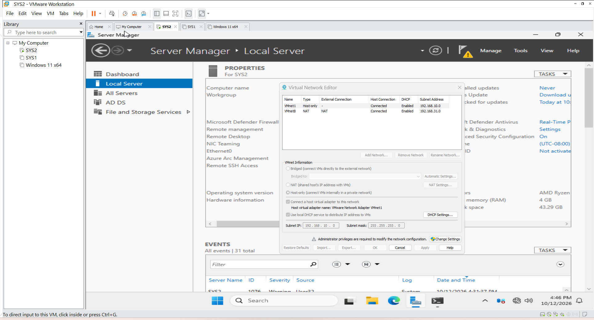
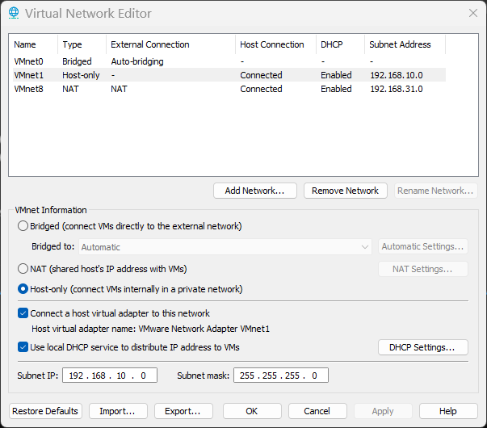
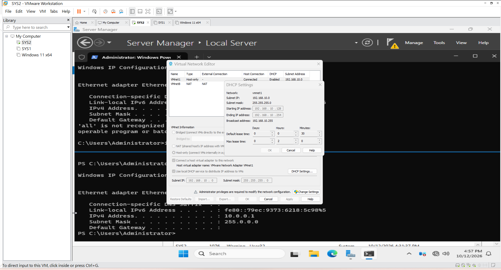
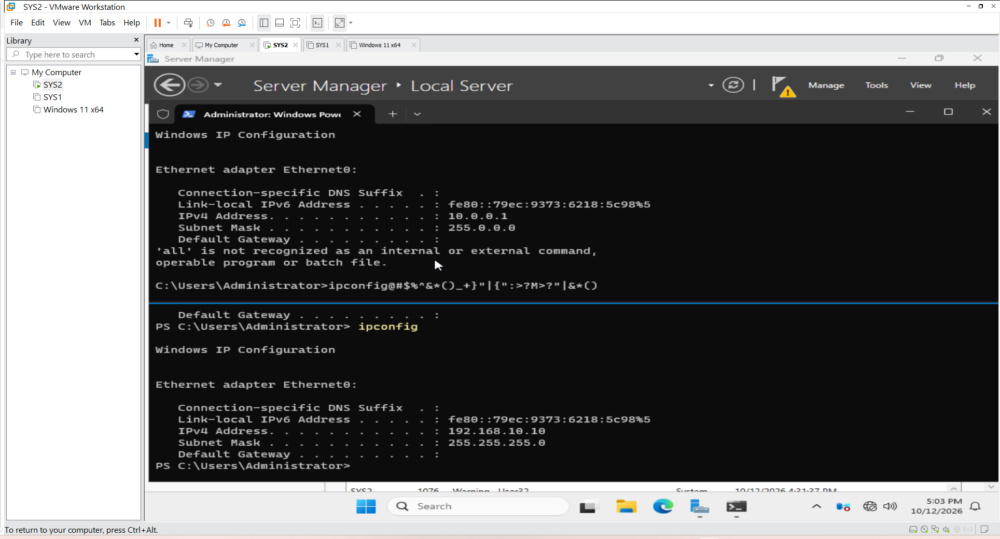
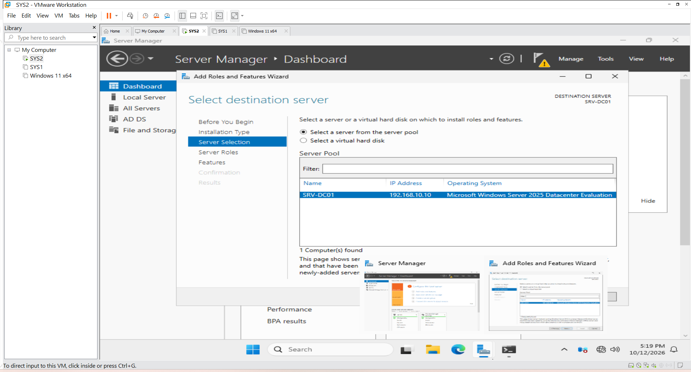
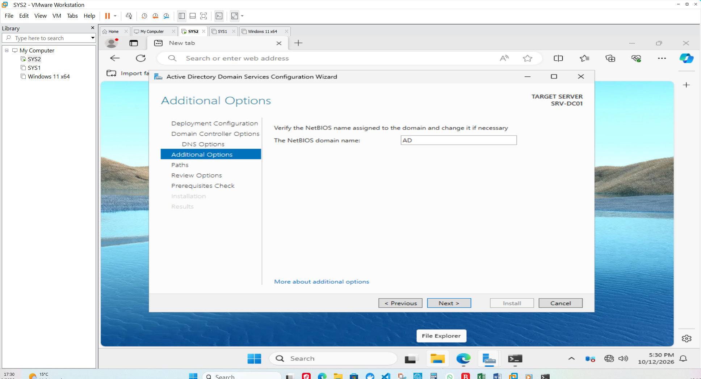
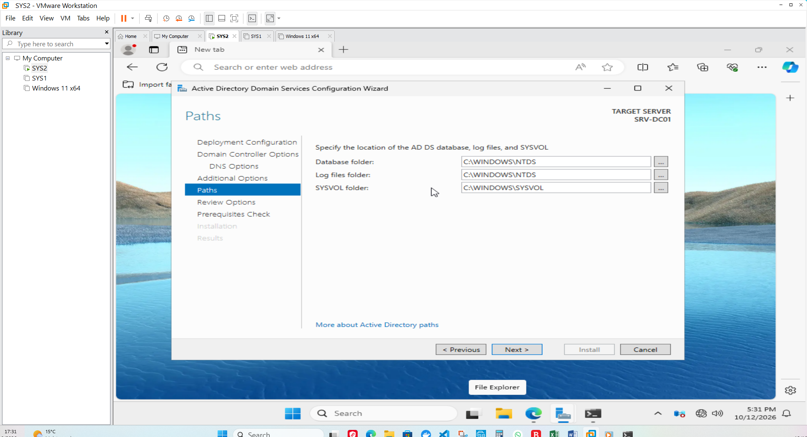
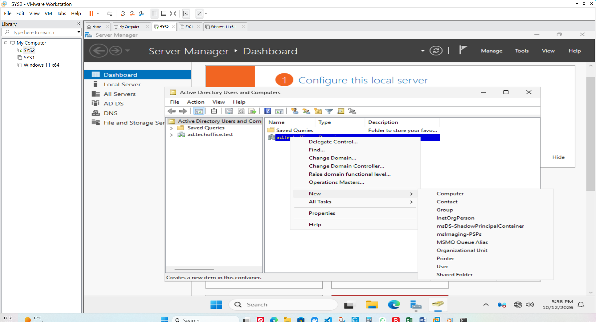
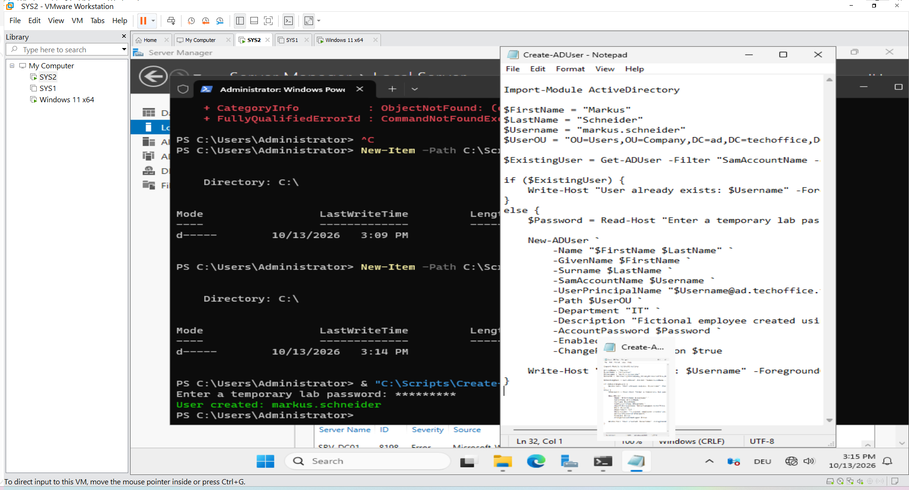

# Windows Server & Active Directory Administration Lab

## Project Overview

This project demonstrates hands-on Windows Server administration in a simulated company environment called **TechOffice GmbH**.

The lab focuses on Windows Server, Active Directory Domain Services (AD DS), DNS, user and organisational unit (OU) management, and PowerShell automation.

The objective is to practise common IT administration tasks, verify configurations, troubleshoot problems, and document the procedures in a reusable technical runbook.

## Lab Environment

- **Virtualisation:** VMware Workstation Pro 17
- **Server operating system:** Windows Server 2025
- **Client operating system:** Windows 11
- **Active Directory domain:** `ad.techoffice.test`
- **Domain controller:** `SRV-DC01`
- **Domain controller IP:** `192.168.x.x`
- **Internal lab network:** `192.168.x.x/24`
- **PowerShell:** Active Directory administration and automation

## Work Completed

- Created the virtual lab environment in VMware.
- Configured the server's static IP address and DNS settings.
- Installed Active Directory Domain Services and promoted the server to a domain controller.
- Created a company OU structure for users, computers, groups, and servers.
- Created initial test user accounts.
- Prepared a CSV file containing 50 fictional employee records.
- Used PowerShell to automate the creation of missing Active Directory user accounts.
- Began validating the resulting accounts.

## Planned Work

- Verify user attributes and account counts.
- Create department security groups and configure group membership.
- Join the Windows 11 client to the domain.
- Configure and test Group Policy.
- Configure file shares and NTFS permissions.
- Practise DNS, DHCP, backup, event-log analysis, and troubleshooting.
- Document scripts, test results, and lessons learned.

## Documentation and Evidence

Detailed setup instructions, PowerShell scripts, architecture diagrams, verification results, and troubleshooting notes will be added as the lab progresses.

**Note:** This is a learning lab using fictional company data. Features listed under planned work are not represented as completed until they have been configured and tested.