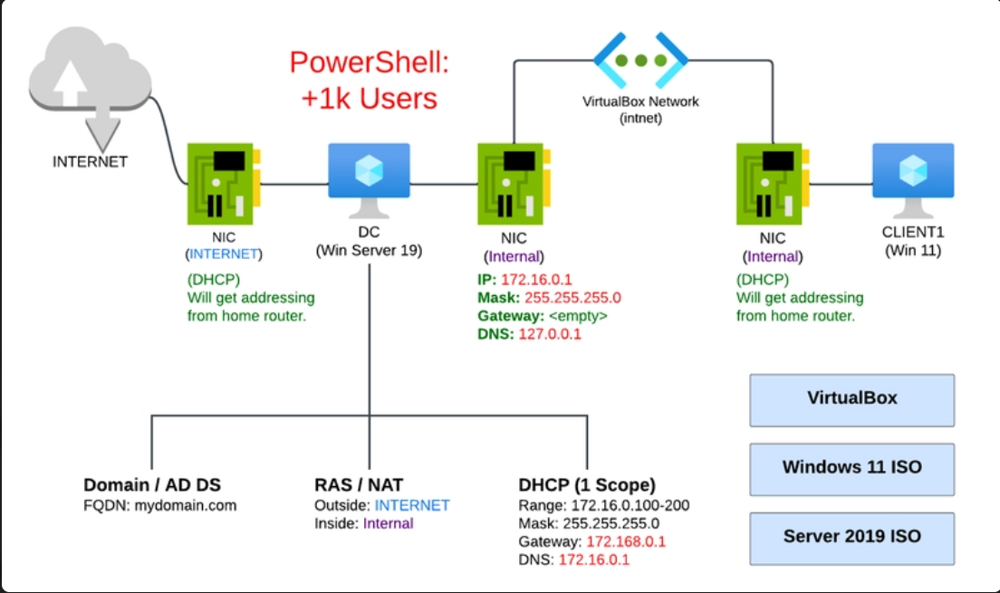

# Windows Server & Active Directory Administration Lab



#### Project Overview

This project demonstrates hands-on Windows Server administration in a simulated company environment called **TechOffice GmbH**.
The lab focuses on Windows Server 2025, Active Directory Domain Services (AD DS), organisational unit (OU) design, user and security group management, PowerShell automation, Group Policy, file sharing, and NTFS permissions.
The objective is to practise realistic IT administration tasks, verify configurations, troubleshoot access and policy issues, and document the results in a reusable technical runbook.

#### Lab Environment

| Component | Configuration |
|---|---|
| Virtualisation platform | VMware Workstation Pro 17.6.2 |
| Host operating system | Windows 11 |
| Server operating system | Windows Server 2025 |
| Client operating system | Windows 11 |
| Domain controller | `SRV-DC01` |
| Domain controller IP address | `192.168.x.x` |
| Internal lab network | `192.168.x.0/24` |
| Virtual network | VMware host-only network (VMnet1) |
| Active Directory domain | `ad.techoffice.test` |
| Administration tools | Server Manager, Active Directory Users and Computers (ADUC), Group Policy Management, PowerShell |

### Work Completed

##### 1. VMware Lab Setup and Network Configuration

- Created the virtual lab environment using VMware Workstation.
- Configured the host-only virtual network for the lab.
- Configured the Windows Server hostname and static IPv4 address.
- Checked the server's network and DNS settings.

##### 2. Active Directory Domain Services

- Installed the Active Directory Domain Services role.
- Promoted the server to a domain controller.
- Created the Active Directory domain `ad.techoffice.test`.
- Reviewed the domain controller and DNS configuration.

##### 3. Organizational Units and User Management

- Created the `Company` Organizational Unit.
- Created the `Users`, `Computers`, `Groups`, and `Servers` child OUs.
- Created an initial user account manually using Active Directory Users and Computers.
- Organised directory objects within the lab structure.

##### 4. PowerShell User Provisioning

- Prepared a CSV file containing 50 fictional employee records.
- Developed a PowerShell script to automate individual user creation.
- Used a separate PowerShell script to process employee records in bulk.
- Implemented checks to skip accounts that already existed.
- Generated a provisioning results report.
- Began validating the resulting Active Directory accounts.
 
##### 5. Active Directory Users, Security Groups & Windows 11 Domain Join
 
- Created and organised Active Directory user accounts.
- Created department-based Global Security groups.
- Audited user department attributes and group memberships.
- Intentionally left two users unassigned to their expected security groups for future access-control testing.
- Configured client DNS to locate the domain controller.
- Troubleshot DNS resolution and domain-controller discovery.
- Joined the Windows 11 client to the Active Directory domain.
- Tested domain-user sign-in and documented a password-change workaround.
- Recorded troubleshooting cases, verification results, and lessons learned.

##### 6. File Server and Access Permissions

- Created and shared the C:\Marketing folder on Windows Server 2025.
- Configured NTFS permissions for the GG-Marketing security group.
- Configured SMB share permissions for department-based access.
- Tested network file access from the Windows 11 domain client.
- Troubleshot read-only access and corrected share permissions to allow Marketing users to create files.
- Verified that a Marketing user could create a new file.
- Tested restricted write access using Julia Schulz's IT account.
- Documented permission inheritance, troubleshooting steps, and access-control test results.

##### 7. Group Policy Management and Security Filtering

- 7A – Baseline User Restrictions: Configure and test user restrictions using a baseline Group Policy Object (GPO).
- 7B – Targeted Group Policy Deployment: Apply additional user restrictions through Active Directory security groups and GPO security filtering.
- 7C – Non-Member Verification: Compare policy results for a group member and a non-member using gpupdate and gpresult.

##### 8. File Server Administration and NTFS Permissions

- **Part 8.1 — Department File Sharing:** Configured Finance and HR folders with group-based permissions and tested departmental access.
- **Part 8.2 — Confidential File Access:** Restricted the Finance confidential folder to members of `GG-Finance-Confidential` and tested authorised and unauthorised access.
- **Part 8.3 — Personal Restricted Folder:** Configured an employee-specific folder for Nina Braun and verified that another employee could not access it.
- **Part 8.4 — Public and Controlled-Write Folders:** Configured employee read access to an announcements folder and controlled publishing through `GG-Announcement-Publishers`.
- **Part 8.5 — Troubleshooting and Final Validation:** Reviewed permissions, investigated access restrictions, and consolidated test results.

### Documentation and Runbooks

The `docs` directory contains detailed procedures, technical explanations, screenshot evidence, verification commands, and troubleshooting notes.

| Document | Description |
|---|---|
| [Part 1 — VMware Lab Setup](docs/01-vmware-lab-setup.md) | Virtualisation, network design, and initial server configuration |
| [Part 2 — Active Directory Installation](docs/02-active-directory-installation.md) | AD DS role installation and domain controller promotion |
| [Part 3 — OU and User Management](docs/03-ou-and-user-management.md) | OU structure and manual user administration |
| [Part 4 — PowerShell User Provisioning](docs/04-powershell-user-provisioning.md) | User automation and bulk provisioning from CSV |
| [Part 5 — Active Directory Users and Security Groups](docs/05-Active-Directory-Users-and-Security-Groups.md) | Security groups, group membership, domain join, and sign-in troubleshooting |
| [Part 6 — File Server and Access Permissions](docs/06-File-Server-and-Access-Permissions.md) | SMB and NTFS permissions, access-control testing, and troubleshooting |
| [Part 7 — Group Policy Management and Security Filtering](docs/Part-7-Group-Policy-Management.md) | Baseline GPOs, targeted policies, security filtering, and non-member verification |
| [Part-8.1 — Department File Sharing](Part-8.1-Department-File-Sharing.md) | Finance and HR folder permissions |
| [Part-8.2 — Confidential File Access](Part-8.2-Confidential-File-Access.md) | Restricted access to confidential Finance data |
| [Part-8.3 — Personal Restricted Folder](Part-8.3-Personal-Restricted-Folder.md) | Employee-specific folder permissions |
| [Part-8.4 — Public and Controlled-Write Folders](Part-8.4-Public-Controlled-Write.md) | Read-only access and controlled publishing |
| [Part-8.5 — Troubleshooting and Final Validation](Part-8.5-Troubleshooting-and-Validation.md) | Permission checks, troubleshooting, and final validation |

## Repository Structure

```text
Windows-Server-Active-Directory/
├── README.md
├── Project-Archtecture.png
├── Images/
├── docs/
│   ├── 01-vmware-lab-setup.md
│   ├── 02-active-directory-installation.md
│   ├── 03-ou-and-user-management.md
│   ├── 04-powershell-user-provisioning.md
│   ├── 05-Active-Directory-Users-and-Security-Groups.md
│   ├── 06-File-Server-and-Access-Permissions.md
│   ├── Part-7-Group-Policy-Management.md
│   ├── Part-08.1-Department-File-Sharing.md
│   ├── Part-08.2-Confidential-File-Access.md
│   ├── Part-08.3-Personal-Restricted-Folder.md
│   ├── Part-08.4-Public-Controlled-Write.md
│   └── Part-08.5-Troubleshooting-and-Validation.md
└── scripts/
    ├── New-ADUser.ps1
    ├── Import-ADUsersFromCsv.ps1
```
## Project Goal

This project demonstrates my practical skills in Windows Server and Active Directory administration, including user and security group management, organisational unit (OU) design, PowerShell automation, Group Policy, file sharing, NTFS permissions, access control, and troubleshooting.

The scope of this project covers the foundational administration of Windows Server and Active Directory, from initial lab setup through identity management, policy configuration, and file-server access control.

To explore additional infrastructure topics in greater depth, I plan to develop separate projects in dedicated repositories:

- **DNS and DHCP Infrastructure Services:** DNS administration, DHCP configuration, network services, and troubleshooting.
- **Windows Backup, Recovery and Disaster Recovery:** Backup strategies, file and system recovery, Active Directory recovery, and disaster-recovery procedures.
- **Windows Server Operations and Hybrid Cloud:** Server monitoring, maintenance, operational troubleshooting, and hybrid Windows and Azure administration.

Together, these projects will form a practical portfolio demonstrating my developing skills in Windows system administration, IT infrastructure, and cloud technologies through hands-on labs, verification results, troubleshooting scenarios, and technical documentation.