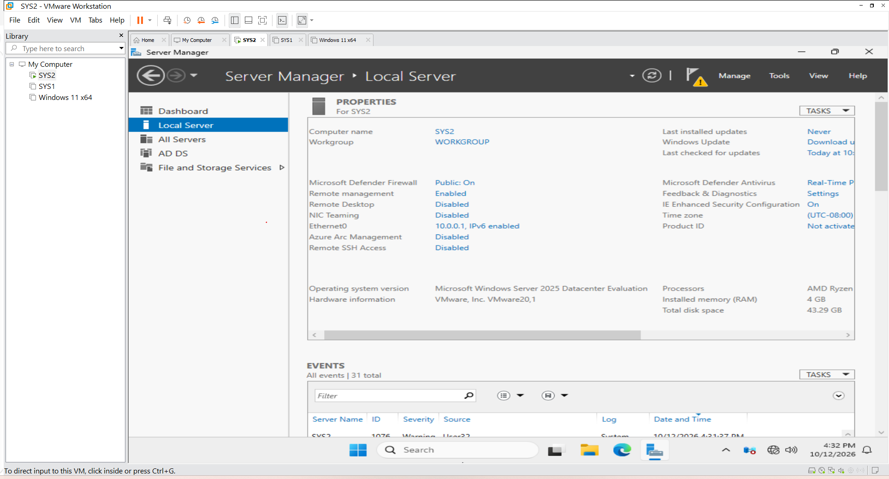
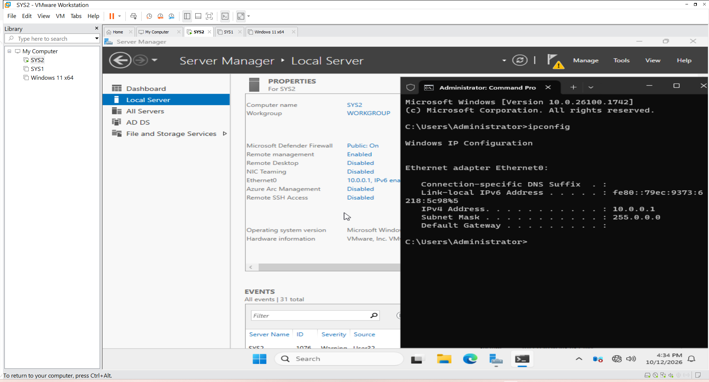
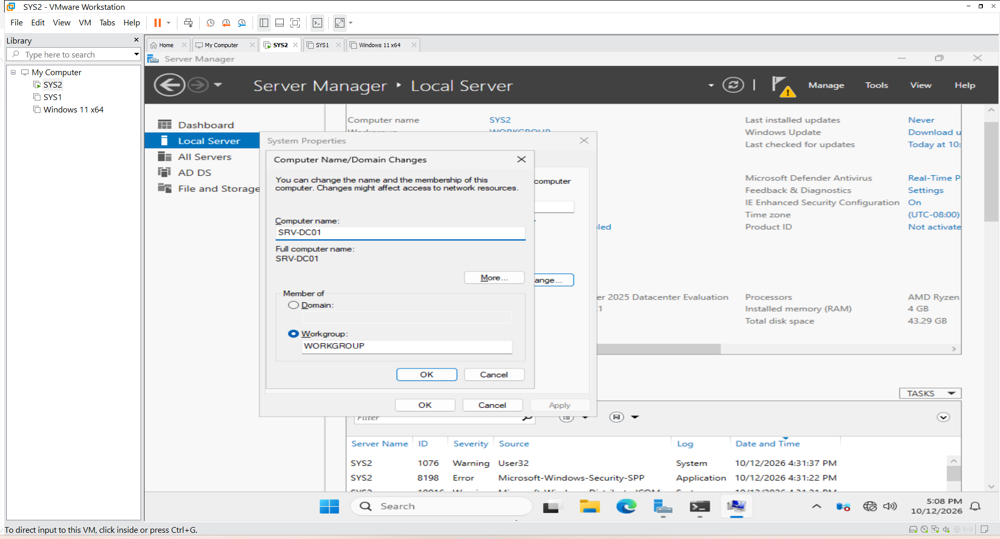
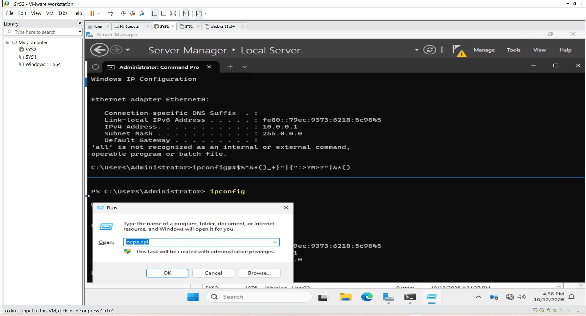
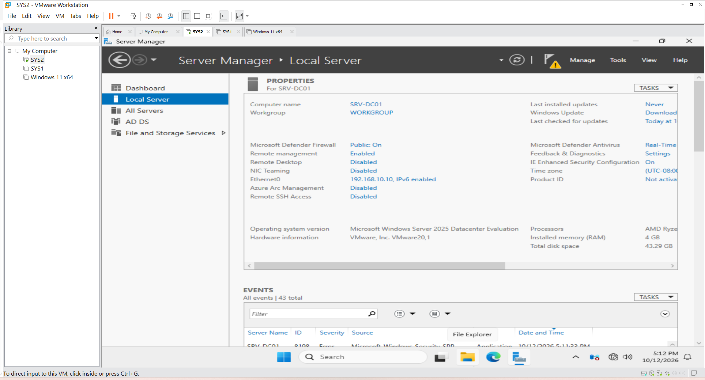

### VMware Lab Setup

#### 1. Objective

The objective of this task was to build a virtual lab environment for practising Windows Server administration and Active Directory.

The lab simulates a small company environment in which a Windows Server machine provides centralised identity and infrastructure services.

#### 2. Lab Environment

Component                                                 Configuration

Host operating system                                     Windows 11
Virtualisation platform                                   VMware Workstation Pro 17.6.2
Server operating system                                   Windows Server 2025
Server hostname                                           SRV-DC01
Server virtual network                                    Host-only network (VMnet1)
Lab network                                               192.168.10.0/24
Domain                                                    ad.techoffice.test
Client virtual machine                                    windows11-pc1

##### 3. Network Design

The lab uses a VMware host-only network to allow communication between virtual machines without directly exposing the lab network to the physical network.

The host-only network uses the 192.168.10.0/24 subnet.

The Windows Server virtual machine is configured with the following static network settings:

Setting                                                    Value

IPv4 address                                            192.168.10.10
Subnet mask                                             255.255.255.0
Preferred DNS server                                    192.168.10.10
Default gateway                                         Not configured

The server uses its own IP address for DNS because it will host the DNS service required for the Active Directory domain.

Important: The default gateway and DNS settings depend on the lab design. A gateway is not required for communication within this isolated subnet.

##### 4. Procedure

Step 1: Prepare the virtualisation environment

VMware Workstation Pro was used to create and manage the virtual machines required for the lab.
Create a dedicated virtual network for communication between the Windows Server and client virtual machines.

Step 2: Configure the virtual network

A host-only virtual network (VMnet1) was used for communication between the lab virtual machines.

The network subnet was configured as 192.168.10.0/24.

Step 3: Prepare the Windows Server virtual machine

The Windows Server virtual machine was prepared for use as the central server in the lab.

The server was subsequently named SRV-DC01.

Step 4: Configure the server network

A static IPv4 address was configured for the server so that its address would remain predictable for DNS and Active Directory services.

Step 5: Verify the network configuration

The server's IP configuration was checked to confirm the IPv4 address, subnet mask, and DNS server settings.

Useful verification commands include:

ipconfig /all
hostname

#####  5. Expected Outcome

At the end of this stage:

VMware provided the virtualisation environment.

The lab used a dedicated host-only network.

The server had a predictable static IP address.

The server was prepared for the installation and configuration of Active Directory Domain Services.

##### 6. Technical Notes

A static IP address is important for infrastructure servers because client machines and services need to locate them reliably.

Active Directory Domain Services depends on DNS to locate domain controllers and other domain services. Incorrect DNS configuration can cause domain-join, authentication, and name-resolution problems.

The host-only network provides an isolated environment for practising administration without requiring the lab machines to be directly connected to the physical LAN.