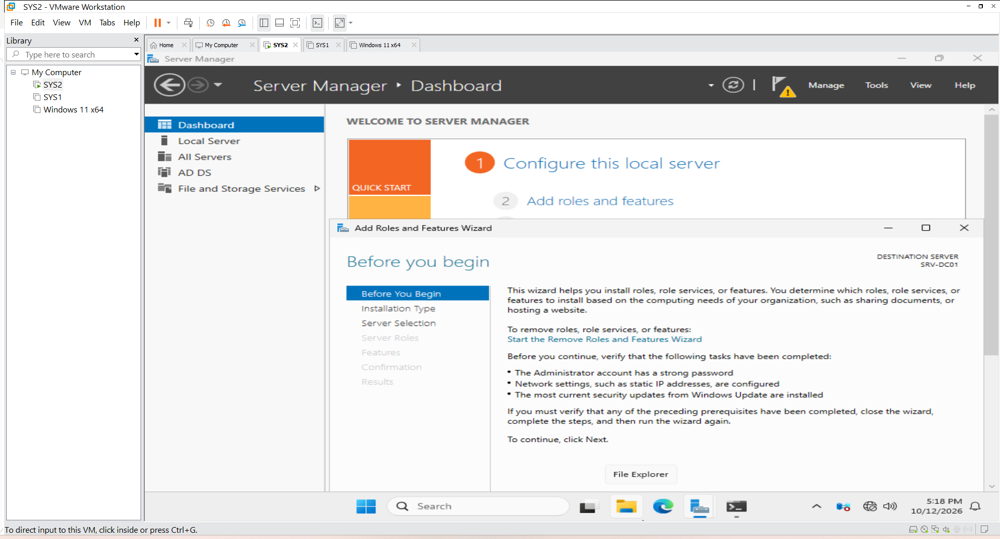
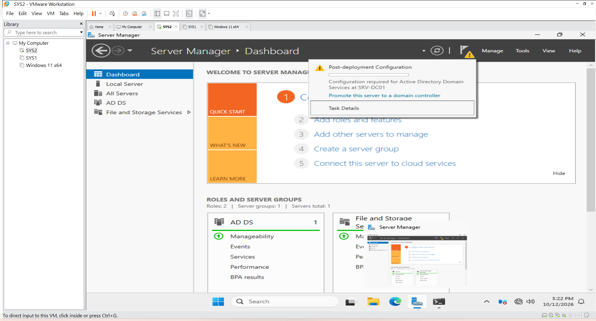
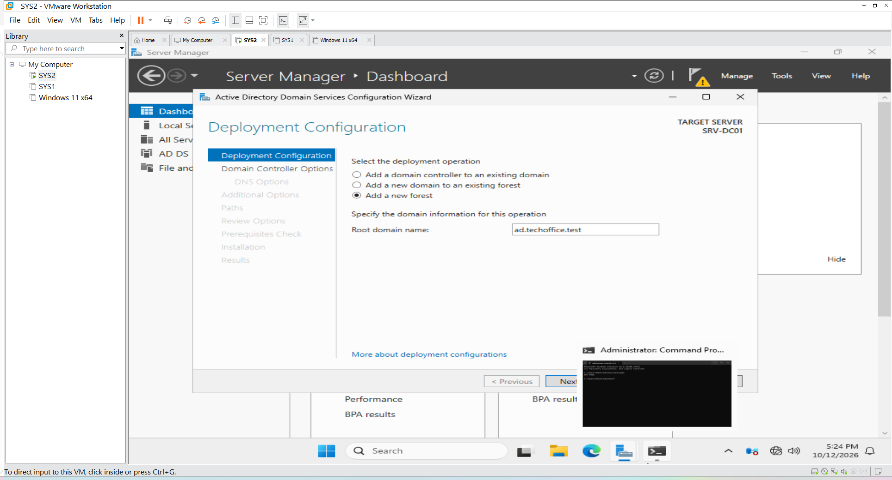
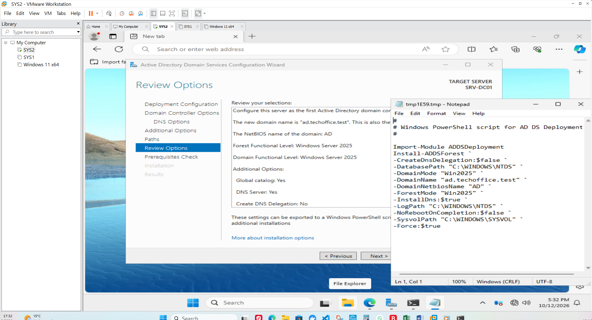
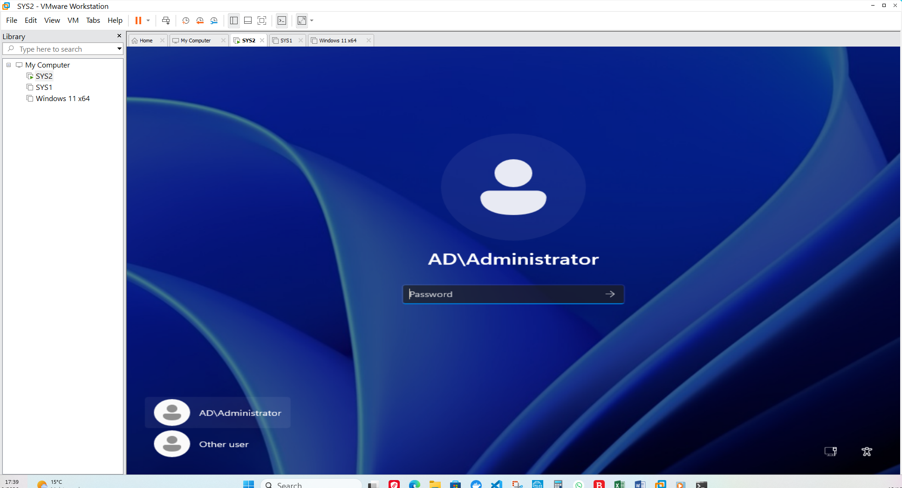

##  Active Directory Domain Services Installation

#### 1. Objective

The objective of this stage was to install Active Directory Domain Services (AD DS) on the Windows Server 2025 virtual machine and promote the server to a domain controller.

This establishes a central identity and authentication service for the simulated company environment, TechOffice GmbH.

The Active Directory domain created for this lab is:

`ad.techoffice.test`

#### 2. Lab Environment

| Component | Configuration |
|---|---|
| Server operating system | Windows Server 2025 |
| Server hostname | SRV-DC01 |
| Server IPv4 address | 192.168.10.10 |
| Active Directory domain | ad.techoffice.test |
| Directory service | Active Directory Domain Services (AD DS) |
| DNS service | DNS Server |
| Virtualisation platform | VMware Workstation Pro 17.6.2 |

#### 3. Active Directory Overview

Active Directory Domain Services is Microsoft's directory service for centrally managing identities and resources in a Windows domain environment.

It enables administrators to manage user accounts, computer accounts, groups, authentication, and access to domain resources from a central location.

A domain controller is a Windows Server that hosts Active Directory Domain Services and participates in domain authentication.

DNS is also essential because domain-joined computers use DNS records to locate domain controllers and other Active Directory services.

#### 4. Installation and Configuration Procedure

##### Step 1: Open Server Manager

Server Manager was used to manage Windows Server roles and features.

The Add Roles and Features Wizard provides a guided process for installing server roles such as Active Directory Domain Services.




##### Step 2: Start the Add Roles and Features Wizard

The Add Roles and Features Wizard was opened to begin installing the required server role.

The wizard allows administrators to select the destination server and the roles or features required for the planned configuration.


##### Step 3: Select Active Directory Domain Services

The Active Directory Domain Services role was selected for installation.

AD DS provides the directory and authentication services needed to manage users and computers centrally within a Windows domain.

The associated management tools and required features were included when prompted by the wizard.

##### Step 4: Install the AD DS role

The installation was started after reviewing the selected role and required components.

Installing the role adds the AD DS binaries and management capabilities to the server. At this point, installing the role alone does not yet make the server a domain controller.



##### Step 5: Start domain controller promotion

After the role installation, the server was configured for domain controller promotion using the post-deployment option in Server Manager.
Promotion configures the server to host Active Directory Domain Services for the domain.

##### Step 6: Configure the deployment

The new forest deployment option was selected to create a new Active Directory domain environment.
The root domain name for this lab was entered as:   `ad.techoffice.test`
A new forest is appropriate for a standalone lab that is not joining an existing Active Directory forest.



##### Step 7: Review domain controller options

The domain controller options were reviewed before continuing.

These options include domain controller capabilities, the Directory Services Restore Mode (DSRM) password, and other settings presented by the wizard.
The DSRM password is used for specific directory recovery and maintenance scenarios. It should be stored securely and must not be included in public documentation or screenshots.


##### Step 8: Review DNS and additional configuration

The wizard's DNS and additional configuration pages were reviewed as part of the promotion process.
DNS integration is important because Active Directory clients need to locate domain controllers through service records and other DNS information.

##### Step 9: Review prerequisites and promote the server

The configuration was reviewed and the prerequisite checks were allowed to run.
After the checks were passed, the server promotion was started. The process configures the server as a domain controller and may restart the server when completed.



##### Step 10: Sign in to the domain environment

After promotion and restart, the sign-in screen was checked to confirm that the server was operating in the domain environment.
The domain controller can be used to administer the domain through tools such as Active Directory Users and Computers.



#### 5. Verification

The following checks can be performed after promotion.

#### Check the server hostname

Run PowerShell or Command Prompt:

```powershell
hostname
```
Expected hostname:
```text
SRV-DC01
```
#### Check the domain membership

Run:

```powershell
(Get-CimInstance Win32_ComputerSystem).Domain
```
Expected domain:

```text
ad.techoffice.test
```
#### Check the Active Directory domain

If the Active Directory PowerShell module is available, run:

```powershell
Get-ADDomain
```
Review the returned domain information to confirm that the expected domain is available.
#### Check DNS service records

Run:

```powershell
nslookup -type=SRV _ldap._tcp.dc._msdcs.ad.techoffice.test
```
The result should contain the DNS service records used to locate domain controllers. If the query fails, check the DNS server configuration and the domain controller's DNS registration.

#### 6. Completion Criteria

This stage is complete when:

- The AD DS role is installed.
- The server has been promoted to a domain controller.
- The domain `ad.techoffice.test` is available.
- DNS can resolve the required Active Directory records.
- The domain controller can be managed using the appropriate administrative tools.

The next stage covers the creation of the company Organizational Unit structure and the initial user accounts.