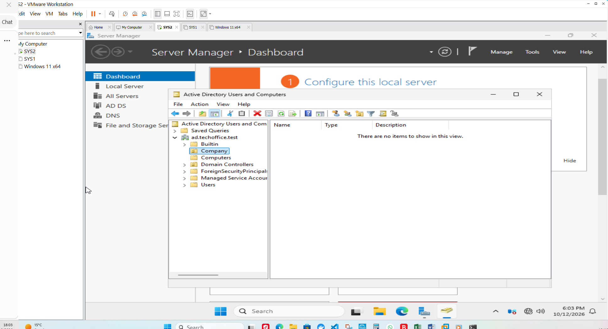
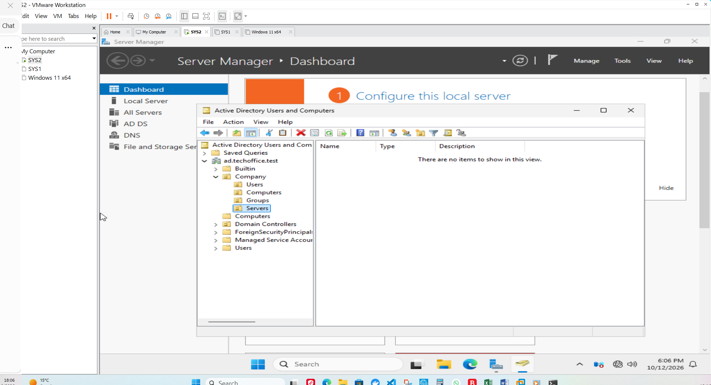
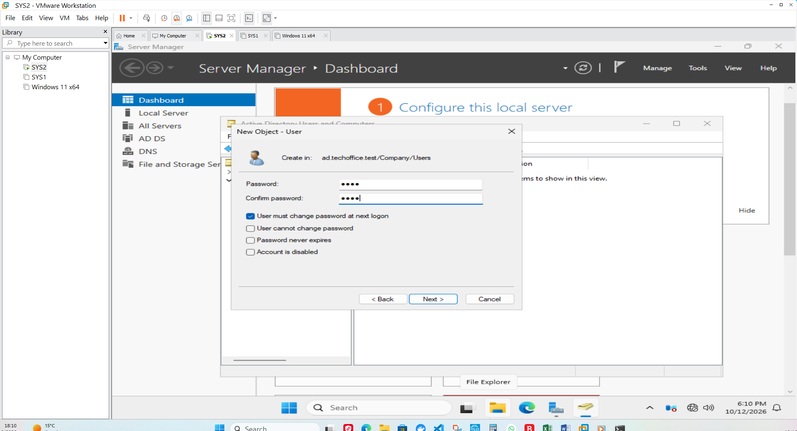
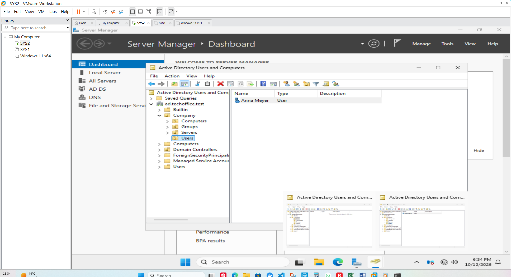

# Active Directory Organizational Units and User Management

#### 1. Objective

The objective of this stage was to organise the Active Directory domain into a logical structure and create initial user accounts for the simulated company, TechOffice GmbH.

Organizational Units (OUs) help administrators organise directory objects and provide a structure for applying Group Policy and delegating administrative responsibilities.

#### 2. Lab Environment

| Component | Configuration |
|---|---|
| Domain controller | SRV-DC01 |
| Operating system | Windows Server 2025 |
| Active Directory domain | ad.techoffice.test |
| Administration tool | Active Directory Users and Computers |
| Company OU | Company |

#### 3. Organizational Unit Design

The following OU structure was created under the Active Directory domain:

```text
ad.techoffice.test
└── Company
    ├── Users
    ├── Computers
    ├── Groups
    └── Servers
```

The purpose of each OU is described below.

| Organizational Unit | Purpose |
|---|---|
| Company | Parent OU for the company's managed directory objects |
| Users | Holds company user accounts |
| Computers | Intended location for domain-joined client computer accounts |
| Groups | Holds security groups used to manage access |
| Servers | Intended location for managed server computer accounts |

The domain controller remains in the built-in **Domain Controllers** OU unless deliberately moved as part of a separate design.

#### 4. Procedure

##### Step 1: Open Active Directory Users and Computers

Active Directory Users and Computers was opened on the domain controller to manage directory objects.

This management console allows administrators to create and organise users, groups, computers, and Organizational Units.

##### Step 2: Locate the domain

The domain `ad.techoffice.test` was expanded in the console to view its existing directory structure.

The domain contains built-in containers and OUs created by Windows. Custom company objects can be organised beneath a dedicated company OU.


##### Step 3: Create the Company OU

A new Organizational Unit named `Company` was created under the domain.

This OU provides a parent container for the company's user, computer, group, and server objects.



##### Step 4: Create child Organizational Units

The following child OUs were created under `Company`:

- `Users`
- `Computers`
- `Groups`
- `Servers`

This structure separates different types of directory objects and prepares the lab for future Group Policy and access-management exercises.



##### Step 5: Create an initial user account manually 

An initial user account was created manually using Active Directory Users and Computers (ADUC).

This provided an opportunity to understand the standard graphical workflow for creating and managing Active Directory user accounts before implementing PowerShell automation.

The account was created under the Company\Users Organizational Unit.



##### Step 6: Verify the initial user account

The account was checked in Active Directory Users and Computers to confirm that it existed in the intended Organizational Unit.

This manual account also provided a useful comparison when learning how to create user accounts through PowerShell.



Open PowerShell on the domain controller and run:

```powershell
Get-ADOrganizationalUnit -Filter * |
    Select-Object Name, DistinguishedName
```

Review the output to confirm that the expected OUs exist.

##### Verify user accounts

To list user accounts in the company Users OU, run:

```powershell
Get-ADUser -Filter * `
    -SearchBase "OU=Users,OU=Company,DC=ad,DC=techoffice,DC=test" |
    Select-Object Name, SamAccountName, Enabled
```

Check that the expected accounts appear and that their enabled status matches the intended configuration.

#### 6. Completion Criteria

This stage is complete when:

- The `Company` OU exists.
- The `Users`, `Computers`, `Groups`, and `Servers` child OUs exist.
- The initial user accounts have been created in the intended location.
- The structure can be viewed in Active Directory Users and Computers.
- The directory structure can be verified using PowerShell.

The next stage demonstrates bulk user provisioning using PowerShell and a CSV file.