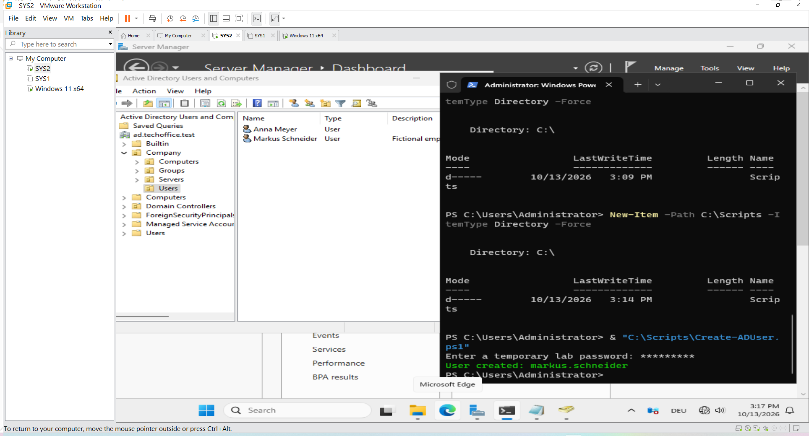

# PowerShell Active Directory User Provisioning

#### 1. Objective

The objective of this stage was to automate Active Directory user management using PowerShell.

Two automation scenarios were implemented in the TechOffice GmbH lab:

1. Creating an individual Active Directory user through a PowerShell script.
2. Provisioning employee accounts in bulk from a CSV file containing 50 employee records.

This stage builds on the manual user creation performed in the previous stage and demonstrates how PowerShell can reduce repetitive administrative work.

#### 2. Lab Environment

| Component | Configuration |
|---|---|
| Server operating system | Windows Server 2025 |
| Domain controller | SRV-DC01 |
| Active Directory domain | ad.techoffice.test |
| User OU | OU=Users,OU=Company |
| Automation tool | Windows PowerShell |
| Directory management module | ActiveDirectory |
| Bulk input file | TechOffice-Employees.csv |
| CSV records | 50 employee records |

### 3. Overview of the Automation

#### 3.1 Manual user creation

An initial user account was created through Active Directory Users and Computers (ADUC).

This provided a reference for understanding the account properties and directory structure before automating the process.



#### 3.2 Single-user PowerShell automation

A PowerShell script was used to create an individual Active Directory user.

Automating the process helps make account creation repeatable and reduces the number of manual steps required.


#### 3.3 Bulk user provisioning

A second PowerShell script processed employee records from `TechOffice-Employees.csv`.

The script checked whether each account already existed, skipped existing accounts, and created missing accounts in the designated Users OU.

This approach helps prevent duplicate account creation when processing an employee list.

### 4. Single-User Automation

#### Step 1: Prepare the PowerShell script

A PowerShell script was prepared to automate the creation of an individual Active Directory user.

The script uses the Active Directory PowerShell module to create the account and specify its directory attributes.


**Script file:** Link to the actual `.ps1` file in the repository.

#### Step 2: Execute the script

The script was executed in the lab environment.

The execution output was checked for errors so that the account creation process could be evaluated.

#### Step 3: Verify the created user

The resulting account was checked in Active Directory Users and Computers or through PowerShell.

For example:

```powershell
Get-ADUser -Identity "Markus Schneider" |
    Select-Object Name, SamAccountName, Enabled
```


### 5. Bulk User Provisioning from CSV

#### Step 1: Prepare the employee CSV file

The file `TechOffice-Employees.csv` was prepared with 50 fictional employee records.

The CSV contained the following columns:

| Column | Purpose |
|---|---|
| FirstName | Employee's first name |
| LastName | Employee's last name |
| Username | Account logon name |
| Department | Employee's department |
| Title | Job title |
| Office | Office location |
| Phone | Telephone number |
| Email | Email address |

The CSV format allows employee information to be processed consistently without entering every account manually.

**Screenshot evidence:** Insert the screenshot showing the CSV file and its column headings.

#### Step 2: Prepare the bulk provisioning script

A PowerShell script was created to import the employee records and process them automatically.

The script used the Active Directory module and targeted the following OU:

```text
OU=Users,OU=Company,DC=ad,DC=techoffice,DC=test
```

The script was designed to:

- Import the employee records from the CSV file.
- Check whether each username already existed.
- Skip accounts that were already present.
- Create missing user accounts.
- Populate the available identity and employee attributes.
- Enable newly created accounts.
- Require a password change at the next logon.
- Export provisioning results to a CSV report.

**Screenshot evidence:** Insert the screenshot showing the bulk provisioning PowerShell script.

**Script file:** Link to the actual bulk provisioning `.ps1` file in the repository.

#### Step 3: Execute the bulk provisioning script

The bulk provisioning script was executed on the domain controller.

The script processed the employee records and reported whether accounts already existed or needed to be created.

**Screenshot evidence:** Insert the screenshot showing the script execution and its output.

#### Step 4: Handle existing accounts

The script checked for existing user accounts before creating new ones.

This is important because the initial manual user accounts overlapped with some of the usernames in the employee CSV.

Skipping existing accounts helps avoid duplicate account creation. However, it also means that existing accounts are not automatically updated with CSV attributes unless the script specifically includes update logic.

**Screenshot evidence:** Insert the output showing existing accounts being skipped, if available.

#### Step 5: Generate the provisioning results report

The script exported its provisioning results to:

```text
C:\Scripts\Provisioning-Results.csv
```

This report provides a record of the accounts processed by the script.

The report can be reviewed to distinguish accounts that were created from accounts that were skipped or encountered errors.

**Screenshot evidence:** Insert the screenshot showing the results CSV, if available.

### 6. Verification

Successful script execution alone does not prove that every account was created correctly. The resulting Active Directory objects should also be checked.

#### Check the number of users in the target OU

```powershell
Get-ADUser -Filter * `
    -SearchBase "OU=Users,OU=Company,DC=ad,DC=techoffice,DC=test" |
    Measure-Object
```

This command counts the user accounts in the target OU.

#### List the user accounts

```powershell
Get-ADUser -Filter * `
    -SearchBase "OU=Users,OU=Company,DC=ad,DC=techoffice,DC=test" |
    Select-Object Name, SamAccountName, Enabled
```

This helps confirm that the accounts exist and shows whether they are enabled.

#### Review the provisioning results

Open `C:\Scripts\Provisioning-Results.csv` and review the reported outcomes.

Compare the report with the original CSV and the accounts already present in Active Directory.

**Important:** Record the actual verified counts and results. Do not assume that every CSV record resulted in a newly created account.

### 7. Understanding the Results

The bulk CSV contained 50 employee records. In the earlier account check, four usernames already existed and 46 were identified as not yet created.

If the input file and directory state remained unchanged, the expected bulk operation would create 46 accounts and skip four existing accounts.

The final number of users in the OU may be different if additional accounts were created manually or if the directory changed afterward. The count should therefore be confirmed using the verification commands.

### 8. Technical Explanation

### Why use PowerShell for user provisioning?

PowerShell allows administrators to automate repetitive tasks, process structured data, and apply consistent account settings.

#### Why use a CSV file?

CSV files provide a simple way to import structured employee information from spreadsheets or other systems.

#### Why check for existing accounts?

A pre-creation check helps prevent duplicate usernames and makes scripts safer to run when some accounts already exist.

#### Why export a results report?

A results report supports troubleshooting, auditing, and reconciliation between the source employee list and the directory.

#### Why separate scripts from documentation?

Keeping `.ps1` files in the repository allows reviewers to inspect the actual implementation. The Markdown document explains the purpose, execution process, and verification without requiring readers to extract code from screenshots.

### 9. Comparison: Manual and Automated Provisioning

| Method | Advantages | Considerations |
|---|---|---|
| Manual creation through ADUC | Useful for individual accounts and learning the GUI workflow | Repetitive when managing many users |
| PowerShell single-user script | Repeatable and faster for individual account creation | Requires correct parameters and error handling |
| PowerShell bulk CSV script | Processes many records consistently and generates a report | Requires valid input data, duplicate checks, and result verification |

### 10. Completion Criteria

This stage is complete when:

- The single-user automation script has been executed and its result checked.
- The bulk provisioning script has processed the employee CSV.
- Existing accounts have been handled according to the script's logic.
- The resulting user accounts have been checked in Active Directory.
- The provisioning report has been reviewed.
- The scripts and relevant documentation are stored in the project repository.

The next stage can build on this foundation by creating security groups, applying Group Policy, and configuring file-share permissions.