## Active Directory Users, Security Groups and Windows 11 Domain Join

#### 5.1 Objective

The objective of this part was to configure user accounts and department security groups in Active Directory, connect a Windows 11 client to the domain, and verify domain-user authentication.

This part also involved troubleshooting DNS configuration, domain-controller discovery, and a domain-user password-change issue.

The lab represents a simulated company environment called **TechOffice GmbH**.

The main tasks were:

- Organise users and security groups in Active Directory.
- Create department-based Global Security groups.
- Review user department assignments and group membership.
- Intentionally leave two users outside their expected department groups for future access-control testing.
- Configure Windows 11 to communicate with the domain controller.
- Join Windows 11 to the Active Directory domain.
- Verify domain-controller discovery and domain-user sign-in.
- Record the issues encountered, troubleshooting performed, and solutions applied.

#### 5.2 Lab Environment

| Component | Configuration |
|---|---|
| Host operating system | Windows 11 |
| Virtualisation platform | VMware Workstation Pro 17.6.2 |
| Server operating system | Windows Server 2025 |
| Domain controller | SRV-DC01 |
| Domain name | ad.techoffice.test |
| Domain controller IP | 192.168.10.10 |
| Lab network | VMware Host-only network (VMnet1) |
| Network subnet | 192.168.10.0/24 |
| Client operating system | Windows 11 |
| DNS server used by client | 192.168.10.10 |

The server and client operate as separate virtual machines connected through the VMware Host-only network.

The domain controller provides Active Directory Domain Services (AD DS) and DNS for the lab domain.

#### 5.3 Active Directory Organisational Structure

The Active Directory domain was organised into company-related organisational units (OUs).

The structure is:

    ad.techoffice.test
    └── Company
        ├── Users
        ├── Computers
        ├── Groups
        └── Servers

The purpose of this structure is to organise company objects logically and provide a foundation for future administration, Group Policy configuration, and access management.

The Users OU contains employee accounts, while the Groups OU contains department security groups.

The Computers and Servers OUs provide a structure for organising computer accounts as the lab expands.

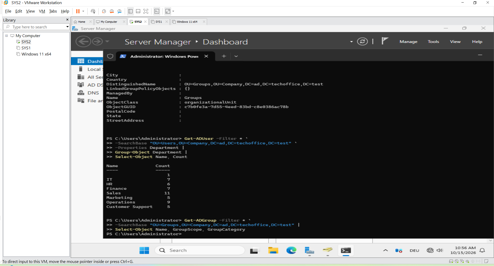

#### 5.4 Department Security Groups

Global Security groups were created to represent the departments in the simulated company.

| Security group | Department |
|---|---|
| GG-IT | IT |
| GG-HR | Human Resources |
| GG-Finance | Finance |
| GG-Sales | Sales |
| GG-Marketing | Marketing |
| GG-Operations | Operations |
| GG-CustomerSupport | Customer Support |

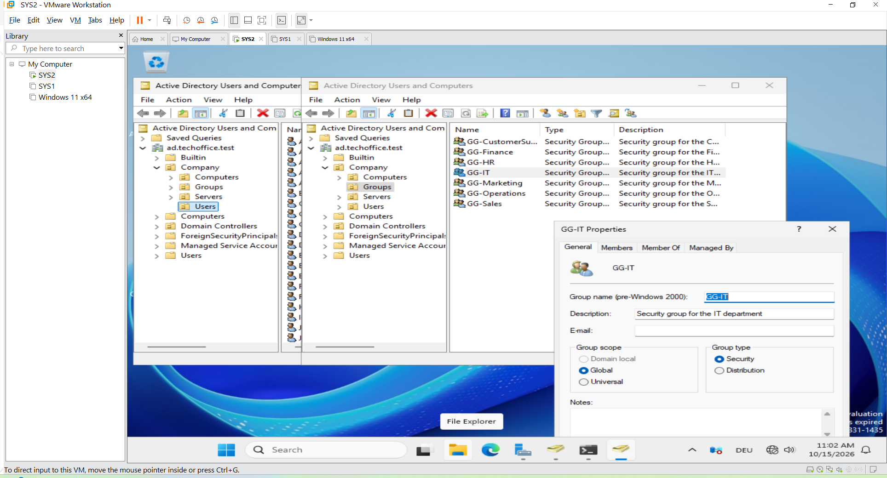

##### Why security groups are used

Security groups make permission management easier than assigning permissions separately to every employee.

For example, if an IT shared folder is intended for the IT department, access can be assigned to `GG-IT`. Users who are members of that group can then receive access according to the permissions configured on the folder.

When employees join, leave, or change departments, administrators can update group membership rather than redesigning every resource permission.

**Important:** creating a group does not automatically grant access to a folder or application. The group must be granted the appropriate permissions on the resource.

#### 5.5 User Accounts and Department Assignments

Employee user accounts were created in Active Directory and organised under the Users OU.

Department information was used to identify the department to which each employee belongs.

The intended mapping is:

| User Department attribute | Expected security group |
|---|---|
| IT | GG-IT |
| HR | GG-HR |
| Finance | GG-Finance |
| Sales | GG-Sales |
| Marketing | GG-Marketing |
| Operations | GG-Operations |

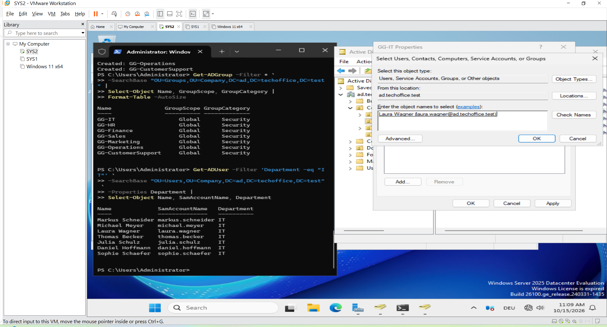

This mapping was used during the group-membership audit.

The audit compared users' Department attributes with their expected department security groups.

This is important because a user account can have the correct Department attribute but still be missing from the corresponding security group. The attribute alone does not provide the permissions assigned to that group.

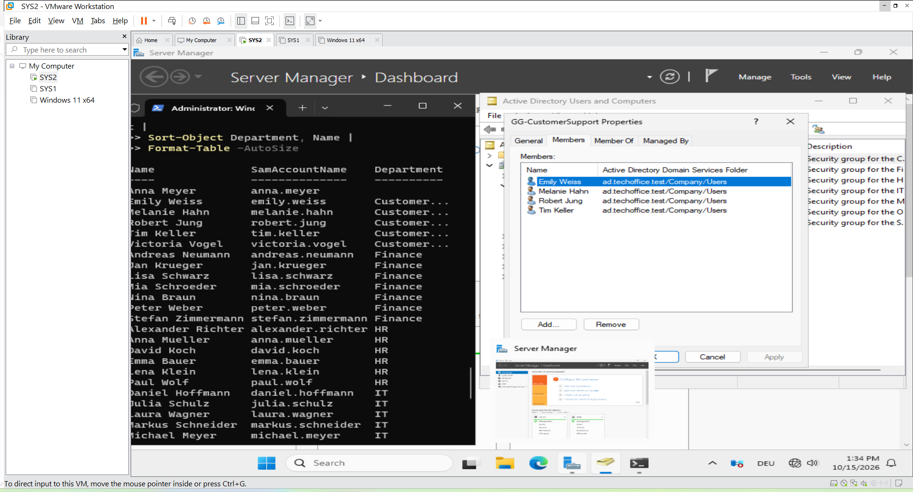

#### 5.6 Group Membership Verification and Audit

Group membership was reviewed to verify that employee accounts were associated with the intended department groups.

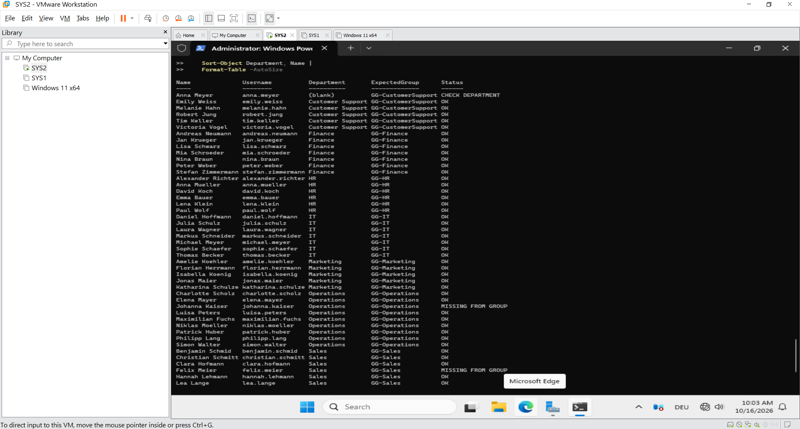

The audit used three types of outcomes:

- **OK:** the expected department group membership was found.
- **MISSING FROM GROUP:** the user's department indicated that membership was expected, but the user was not a member of that group.
- **CHECK DEPARTMENT:** the department information or mapping required further review.

During the audit, two users were identified as missing from their expected department security groups.

These two users were intentionally left unassigned for future access-control testing.

This was a deliberate lab decision rather than an accidental omission. The purpose is to test how department-based permissions behave when a user is not a member of the expected security group.

The affected usernames should be recorded in the lab's private working notes or added here once confirmed.

#### Group membership observations

During an earlier membership check, the following counts were observed:

| Group | Membership count observed |
|---|---:|
| GG-IT | 7 |
| GG-HR | 0 |
| GG-Finance | 7 |
| GG-Sales | 6 |
| GG-Marketing | 4 |
| GG-Operations | 6 |
| GG-CustomerSupport | 4 |

These figures are historical observations from the audit, not a statement of the current group membership. They should be checked again before using them as final results.

The HR group was empty at the time of that check, even though several accounts had HR as their Department attribute. This demonstrated why department attributes and security group membership need to be verified separately.

#### Security consideration

A user who is not a member of their expected department group does not necessarily have no access to company resources. Access may still be granted through other groups, direct permissions, inherited permissions, or other security mechanisms.

The actual effective access must be tested on the relevant resource.

#### 5.7 Windows 11 Client Domain Join

#### Objective

The Windows 11 client was connected to the Active Directory domain `ad.techoffice.test` so that a domain user could sign in to a domain-joined computer.

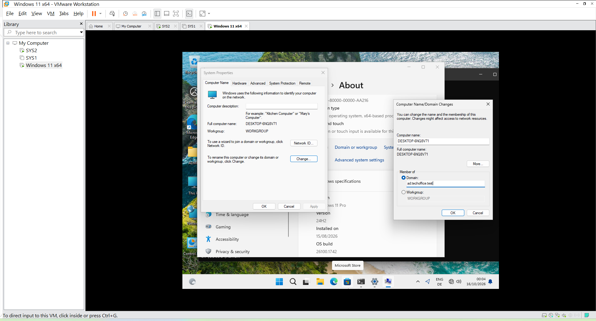

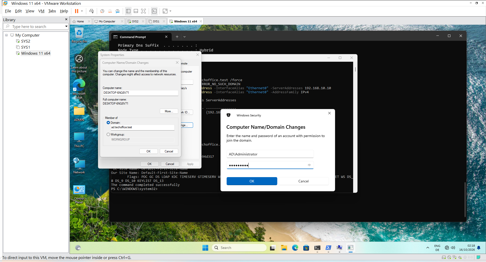

#### Why a domain-joined client is required

In a company environment, employee computers commonly use central identity services rather than relying exclusively on local user accounts.
Joining a client computer to an Active Directory domain establishes domain membership and allows the computer to use domain authentication and applicable domain-managed settings.
For this lab:

- Windows Server 2025 acts as the domain controller.
- Windows 11 acts as the employee workstation.
- Active Directory manages the domain user accounts and security groups.
- DNS helps the client locate the domain controller.

#### Network and DNS configuration

The lab uses the VMware Host-only network VMnet1 with the subnet `192.168.10.0/24`.
The domain controller uses the static IP address `192.168.10.10`.
The Windows 11 client was configured to use `192.168.10.10` as its DNS server.
This configuration allows the client to query the DNS service associated with the Active Directory domain.

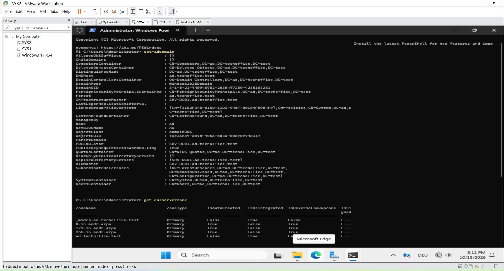

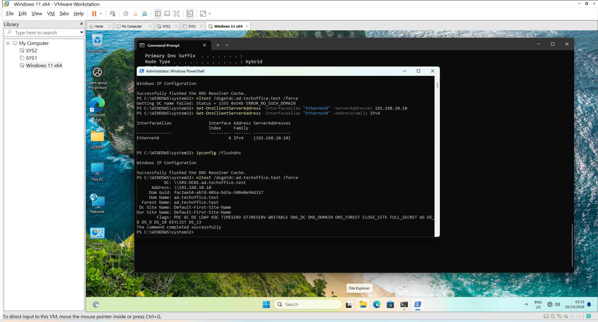

#### Domain join outcome

After the DNS and domain-controller discovery issues were addressed, the Windows 11 client was successfully joined to `ad.techoffice.test`.
A domain-user sign-in was then tested successfully using the account `julia.schulz`.
This confirmed that the lab had progressed beyond creating user accounts on the server to authenticating a domain user on a separate client computer.

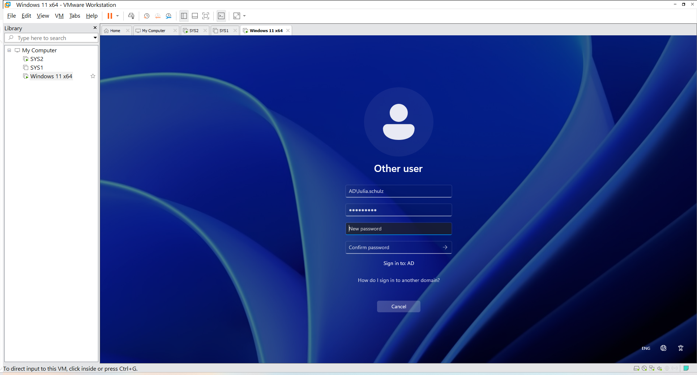

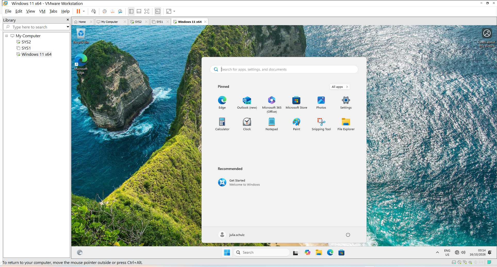

#### 5.8 Troubleshooting Record

This section records the issues encountered during the lab, their technical meaning, the troubleshooting approach, and the outcome.

###### Case 1 — Windows 11 could not recognise or locate the domain

**Observed problem**

During the domain-joining process, Windows 11 had difficulty recognising or locating `ad.techoffice.test`.

**Technical explanation**

Active Directory domain joining depends on locating a domain controller. Windows uses DNS records to discover domain services.
If the client queries an unsuitable DNS server, the internal domain may not resolve correctly even when the server is running.
Other possible causes include incorrect IP settings, a mismatch between VMware virtual networks, or a domain-controller service problem.

**Troubleshooting approach**

The lab network configuration was reviewed, and the client's DNS configuration was corrected to use the domain controller at `192.168.10.10`.

**Resolution**

After the DNS configuration was corrected, the client successfully located the domain controller and the domain join was completed.

**Learning outcome**

DNS is essential for Active Directory domain discovery. Knowing the domain name is not sufficient; the client must be able to resolve and locate the services required for domain membership.

---

###### Case 2 — Verifying domain-controller discovery

**Observed problem**

After correcting DNS, domain-controller discovery needed to be verified before proceeding.

**Troubleshooting approach**

The Windows `nltest` utility was used to request discovery of a domain controller for `ad.techoffice.test`.

**Result**

The discovery test succeeded.

**Resolution**

This provided evidence that Windows 11 could locate a domain controller for the specified domain.

**Learning outcome**

Troubleshooting should use verification checkpoints. A successful domain-controller discovery test helps separate a domain-discovery problem from a later authentication problem.
The discovery test does not prove that every Active Directory service is healthy, but it is a useful diagnostic step.

---

###### Case 3 — Julia Schulz was repeatedly asked to change her password

**Observed problem**

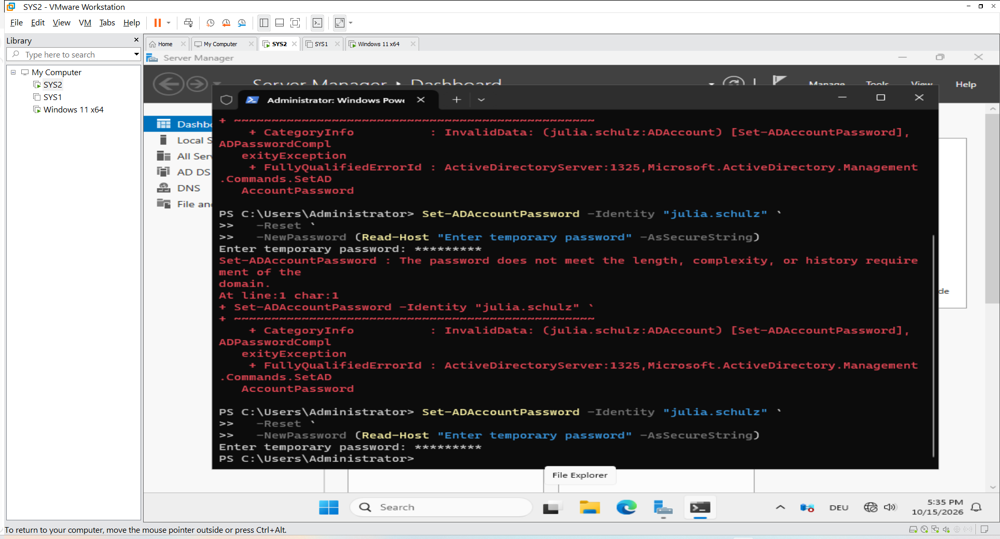

The domain account `julia.schulz` was configured to require a password change at the next sign-in.
The sign-in process allowed the temporary-password and new-password steps, but the password-change requirement repeatedly appeared.

**Investigation**

The account was checked on the domain controller. The account was enabled and was not locked out. The `pwdLastSet` value indicated that a password change was required.
The domain password policy was also reviewed. At the time of the check, the minimum password length was seven characters, password complexity was enabled, password history was set to 24 passwords, and the lockout threshold was zero.

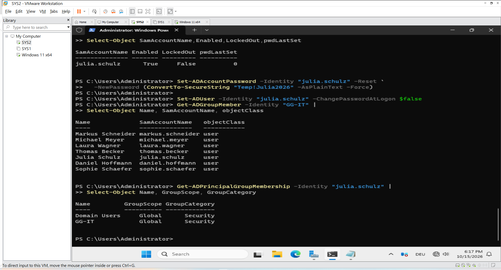

**Action taken**

The account password was reset on the domain controller, and the setting requiring a password change at the next logon was disabled for the lab account.

**Result**

Julia subsequently signed in successfully to the Windows 11 client using her domain credentials.

**Important limitation**

This was a workaround that enabled the lab to continue. The original password-change workflow was not fully diagnosed, so the root cause remains unresolved.
The account's temporary password should be replaced with an individual, suitable password before further testing or continued use.

**Learning outcome**

DNS discovery and user authentication are separate stages. A client can successfully locate the domain controller and still encounter an account, password, or authentication issue.

---

###### Case 4 — Two users were missing from their expected department groups

**Observed problem**

The department-to-group audit identified two users who were not members of their expected department security groups.

**Decision**

Both users were intentionally left unassigned to preserve a test scenario for future access-control validation.
**Current status**

The missing memberships are intentional and should not be treated as completed department-group assignments.

**Next test**

When department folders and permissions are configured, test access using these two accounts and compare the results with users who belong to the expected groups.

**Learning outcome**

User attributes, group membership, and effective resource permissions are different concepts. All three must be considered when investigating access-control behaviour.

#### 5.9 Security and Access-Control Concept

The lab establishes the foundation for department-based access control.
The intended design is to grant permissions to department security groups and manage employee access through membership.

For example:

- Members of `GG-IT` may be granted access to an IT-specific folder.
- Members of `GG-HR` may be granted access to an HR-specific folder.

- Users who are not members of the relevant group can be tested against the same folder to verify the configured access restrictions.

The actual permissions will be configured and validated in a later part of the project.
A group name or membership alone does not prove that a user has or lacks access. Resource permissions and effective access must be tested.

#### 5.10 Verification Summary

| Verification item | Result |
|---|---|
| Active Directory department groups created | Completed |
| User accounts organised in Active Directory | Completed |
| Department attributes and group memberships audited | Completed; two memberships intentionally left missing |
| Windows 11 DNS configuration corrected | Completed |
| Domain-controller discovery tested | Successful |
| Windows 11 joined to `ad.techoffice.test` | Successful |
| Julia Schulz signed in to Windows 11 | Successful after password workaround |
| Original password-change issue fully diagnosed | Outstanding |
| Department folder permissions tested | Outstanding |
| Group Policy application tested | Outstanding |
| Effective access for the two intentionally unassigned users tested | Outstanding |

#### 5.11 Skills Practised

This part provided practical experience with:

- Active Directory user and organisational-unit management.
- Global Security groups and department-based access design.
- Reviewing user attributes and group membership.
- DNS configuration for an Active Directory client.
- Domain-controller discovery and troubleshooting.
- Joining a Windows 11 workstation to an Active Directory domain.
- Testing domain-user authentication.
- Investigating a password-change issue.
- Documenting intentional test conditions and unresolved issues.

#### 5.12 Conclusion

This part established the Active Directory user and security group structure for the TechOffice GmbH lab environment. Department-based security groups were created, user attributes and group memberships were reviewed, and a Windows 11 client was successfully joined to the domain. Domain user sign-in was also tested, and troubleshooting steps were documented.

Two users were intentionally left outside their expected department security groups to support future access-control tests.

The next stage is to configure company resources and permissions, test Group Policy, and verify the actual access granted to users based on their group membership.
