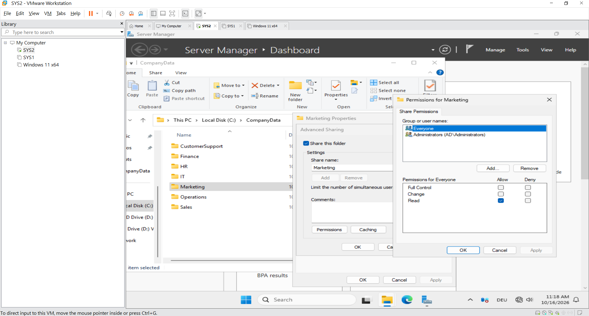
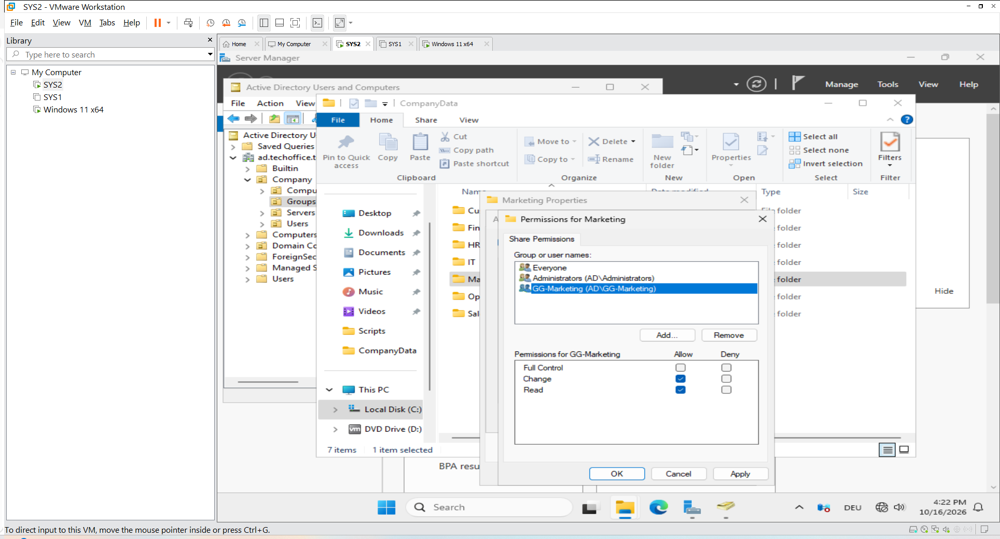
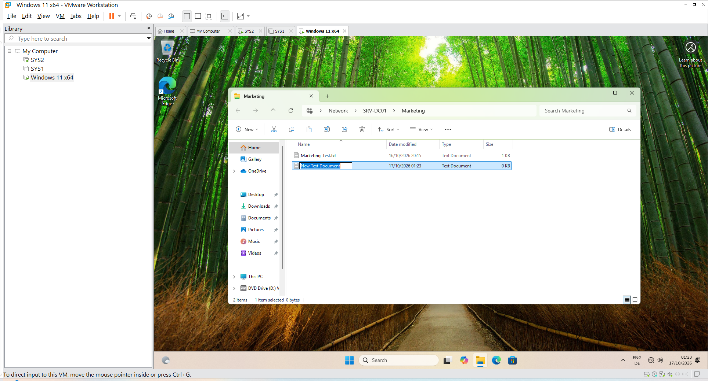
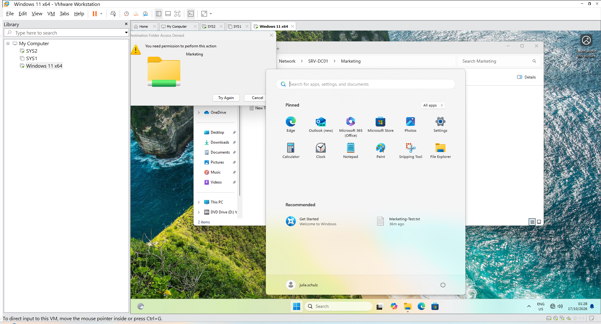
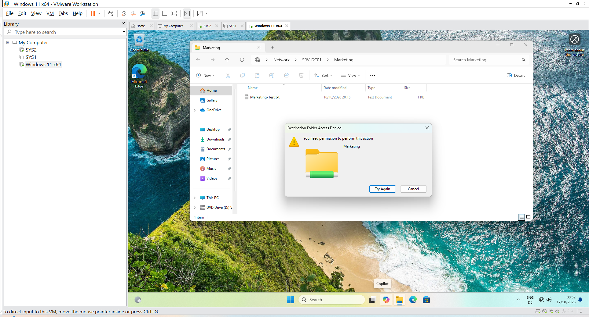

###  File Server and Access Permissions

#### 1. Objective

This lab demonstrates how to configure a shared folder on Windows Server 2025 and control access using Active Directory security groups, NTFS permissions, and SMB share permissions.

The objective was to allow Marketing department users to create and modify files while preventing users outside the Marketing group from creating files in the Marketing folder.

#### 2. Lab Environment

| Component | Configuration |
|---|---|
| Server operating system | Windows Server 2025 |
| Server hostname | SRV-DC01 |
| Active Directory domain | ad.techoffice.test |
| File server folder | C:\Marketing |
| Network share name | Marketing |
| Share path | \\\\SRV-DC01\\Marketing |
| Security group | GG-Marketing |
| Client operating system | Windows 11 |
| Client access | Domain user account |

#### 3. Folder and Share Configuration

Created the `C:\Marketing` folder on `SRV-DC01` and configured it as a network share named `Marketing`.

The share was accessed from the Windows 11 domain client using:

`\\SRV-DC01\Marketing`

A test file named `Marketing-Test.txt` was created on the server to verify access to the shared folder.

#### 4. NTFS Permissions

NTFS permissions were configured on `C:\Marketing`.

| Security principal | Permission |
|---|---|
| GG-Marketing | Modify |
| SYSTEM | Full control |
| Administrators | Full control |

The existing Administrators entries were preserved. Inherited permissions from `C:\` were converted into explicit permissions on the Marketing folder so that the folder's access settings could be reviewed independently.

The two `AD\Users` entries inherited from `C:\` were removed from the Marketing folder after conversion. No permissions were changed on the parent `C:\` drive.

#### 5. SMB Share Permissions

The network share permissions were configured as follows:

| Security principal | Share permission |
|---|---|
| GG-Marketing | Change and Read |
| Everyone | Read |
| Administrators | Full control |

Share permissions and NTFS permissions work together. A network user's effective access is limited by both permission layers.

The `GG-Marketing` group was granted Change and Read at the share level, while its NTFS Modify permission allowed department members to create, edit, and delete permitted files.

#### 6. Access-Control Testing

Tests were performed from the Windows 11 client.

| Test | User | Result |
|---|---|---|
| Open the Marketing network share | Marketing user | Successful |
| Open an existing test file | Marketing user | Successful |
| Create a new text document | Marketing user | Successful after share-permission correction |
| Create a new text document | Julia Schulz (IT) | Denied |

Julia Schulz belongs to the IT department and was not granted membership in `GG-Marketing` for this test. She received a permission message when attempting to create a file.

The results demonstrated that Marketing group members could write to the shared folder, while a user outside the Marketing group could not create files.

#### 7. Troubleshooting Record

##### Issue 1 — Marketing user could read but not create files

**Symptom:** The Marketing user could open the network share and read the existing test file but could not create a new text document.

**Investigation:** The NTFS permissions granted `GG-Marketing` Modify access, but the share permissions granted `Everyone` Read access only.

**Resolution:** Added `GG-Marketing` to the share permissions and granted Change and Read.

**Verification:** The Marketing user successfully created a new text document after the share permissions were updated.

##### Issue 2 — Password-change loop at first logon

**Symptom:** A Marketing user repeatedly returned to the new-password and confirmation screen during the first sign-in attempt.
**Resolution:** Reset the user's temporary password in Active Directory Users and Computers and disabled the requirement to change the password at next logon for the lab test account.
**Verification:** The Marketing user signed in to Windows 11 successfully.
**Note:** The underlying cause of the password-change loop was not conclusively established.

##### Issue 3 — Access denied when an IT user attempted to create a file

**Symptom:** Julia Schulz could not create a new file in the Marketing share.
**Investigation:** Julia was an IT user outside `GG-Marketing`.
**Result:** The denied write attempt was consistent with the intended department-based access restrictions.

#### 8. Key Concepts Demonstrated

- NTFS folder permissions
- SMB network share permissions
- Active Directory security groups
- Department-based access control
- Least-privilege principles
- Permission inheritance
- Network file-sharing troubleshooting
- Positive and negative access-control testing

#### 9. Conclusion

This lab demonstrated how to configure a Windows Server file share and apply department-based permissions using Active Directory security groups.

The Marketing user successfully created a file after the share permissions were corrected. Julia Schulz, an IT user outside the Marketing group, was unable to create a file.

These tests provide practical evidence of Windows Server file-sharing configuration, permission troubleshooting, and access-control verification.

**Scope note:** The tests verified file creation and read access for the Marketing user, and a denied file-creation attempt for Julia. They did not establish that Julia was unable to read the share or prove that every other domain user was blocked from writing.

The next step after Part 6 is to configure and test Group Policy (GPO) and department-based access to company resources.