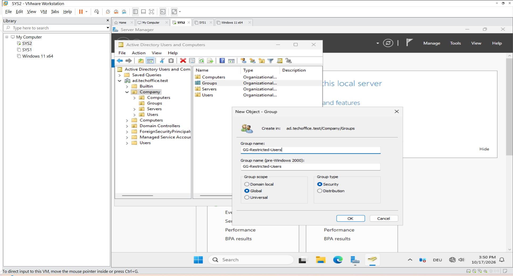
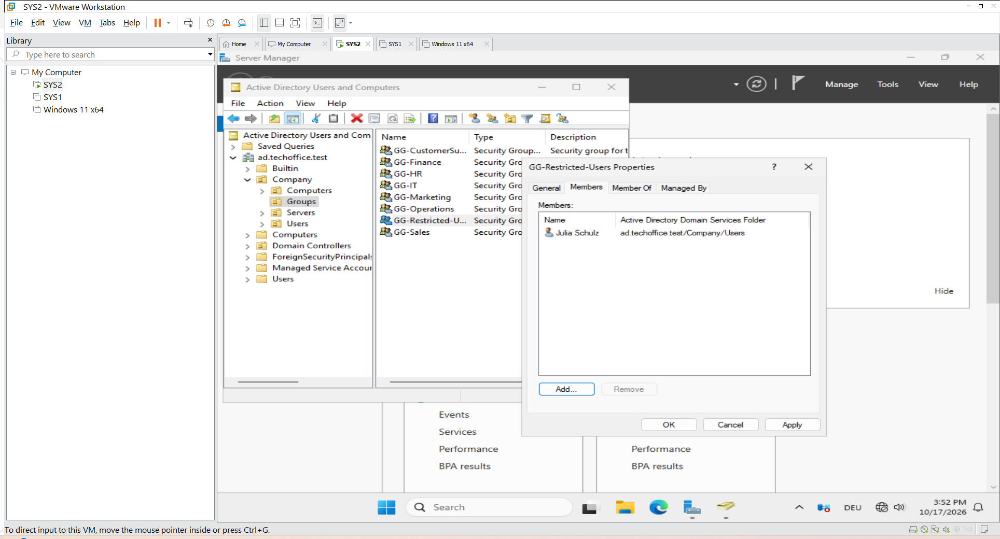
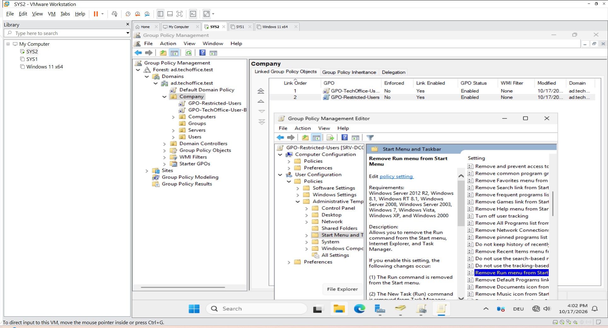
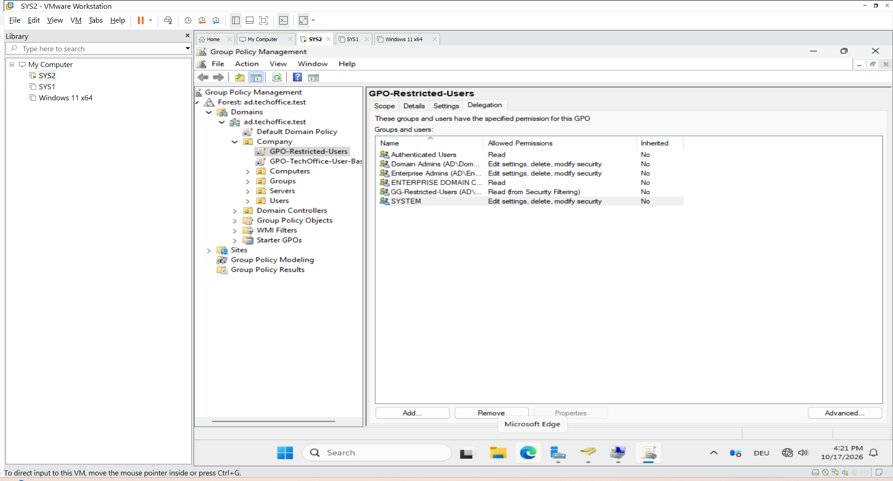
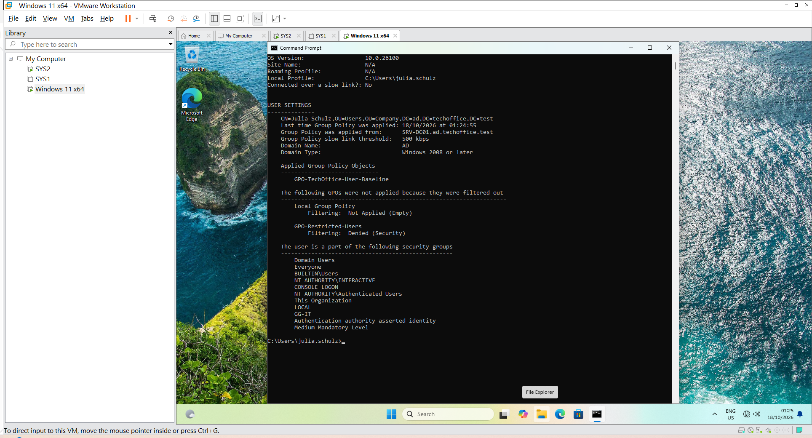
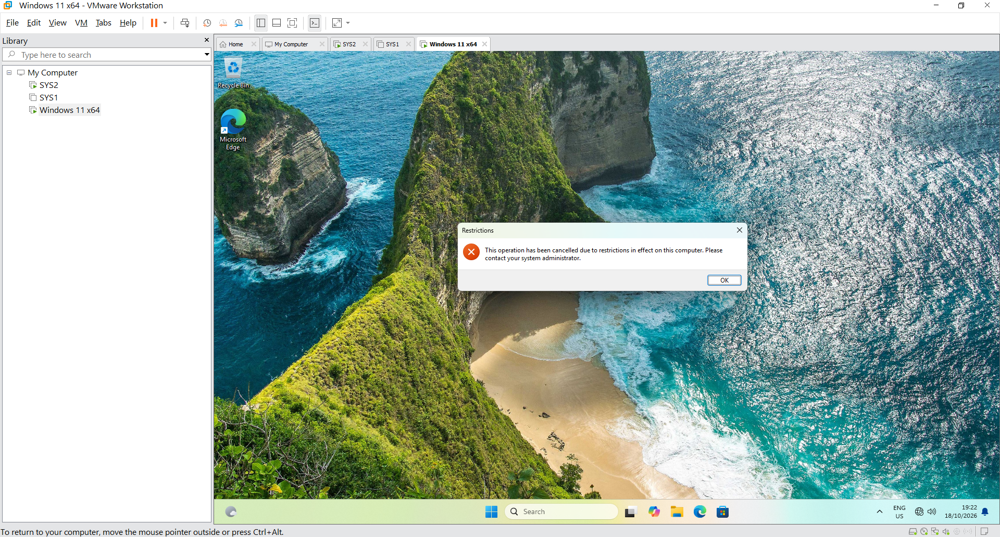
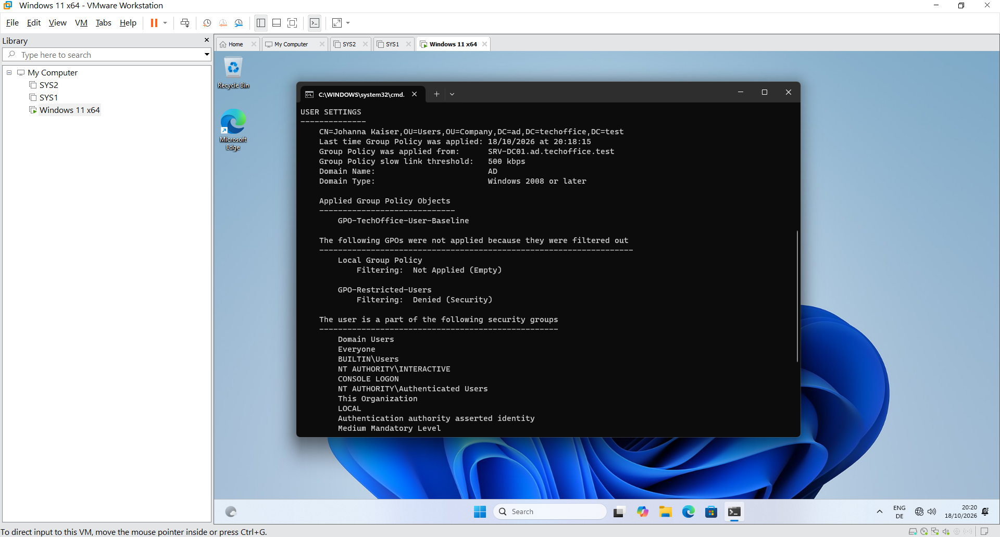

## 7 Group Policy Management and Security Filtering

This lab demonstrates how to create, configure, apply, and verify Group Policy Objects (GPOs) in the TechOffice GmbH Active Directory environment.
The exercise is divided into three parts:

Part 7A – Baseline User Restrictions: Apply common user restrictions through a GPO linked to the Company OU.

Part 7B – Targeted Group Policy Deployment: Apply an additional restriction to selected users using security group filtering.

Part 7C – Non-Member Verification: Confirm that a user outside the targeted security group receives the baseline policy but not the additional restriction.

### Part 7A – Baseline User Restrictions

#### 1. Project Overview

The objective of Part 7A was to configure a baseline Group Policy Object for eligible users in the TechOffice GmbH environment.
The GPO was linked to the Company organizational unit (OU) and configured to restrict desktop background changes and access to Control Panel and Windows Settings.
This exercise demonstrates centralized user configuration through Group Policy rather than configuring each user account individually.

#### 2. Lab Environment

| Component | Configuration |
|---|---|
| Company | TechOffice GmbH |
| Server operating system | Windows Server 2025 |
| Server hostname | SRV-DC01 |
| Active Directory domain | ad.techoffice.test |
| Active Directory OU | Company |
| Group Policy Object (GPO) | GPO-TechOffice-User-Baseline |
| GPO link location | Company OU |
| GPO status | Enabled |
| Security filtering | Authenticated Users |
| User policy 1 | Prevent changing desktop background |
| User policy 2 | Prohibit access to Control Panel and PC settings |
| Client operating system | Windows 11 |
| Client computer role | Domain-joined workstation |
| Test user | Julia Schulz (AD\julia.schulz) |
| Policy verification | `gpupdate` and `gpresult /r` |
| Targeted GPO exercise | Planned — Security Filtering for selected users |

#### 3. Objectives

- Create and link a GPO to an OU.
- Configure user-specific administrative template policies.
- Refresh Group Policy on a domain-joined Windows 11 client.
- Verify the applied policy using gpresult.
- Test the configured restrictions.
- Understand the relationship between OU placement and GPO scope.

#### 4. GPO Creation and Configuration

##### 4.1 Create the GPO

The GPO GPO-TechOffice-User-Baseline was created through Group Policy Management on SRV-DC01 and linked to the Company OU.
The GPO and its link were verified as enabled. Security Filtering was configured for Authenticated Users.
Because the GPO was linked to the parent Company OU, its applicable settings could also reach eligible user accounts in child OUs, subject to security filtering, permissions, inheritance, and other Group Policy processing conditions.


##### 4.2 Configure the desktop background restriction

The following user policy was configured:

-  Policy: Prevent changing desktop background
-  Location:  User Configuration → Policies → Administrative Templates → Control Panel → Personalization
-  Configuration: Enabled

This policy restricts eligible users from changing their desktop background through the normal Windows personalization interface.


##### 4.3 Configure the Control Panel and Settings restriction

The following user policy was also configured:

- Policy: Prohibit access to Control Panel and PC settings
- Configuration: Enabled

This policy restricts access to Control Panel and the Windows Settings app for users to whom the policy applies.
Both restrictions were configured under User Configuration because the intention was to control the user experience, rather than configure a particular computer's system settings.


#### 5. Applying and Verifying Group Policy

##### 5.1 Refresh user policy

On the Windows 11 client, signed in with Julia Schulz's domain account, the following command was used:
- gpupdate /target:user /force
The user policy update completed successfully.


##### 5.2 Verify the applied GPO

The following command was used to inspect the resulting policy information:
- gpresult /r
The output showed:
- User: AD\julia.schulz
- Group Policy applied from: SRV-DC01.ad.techoffice.test
- Applied Group Policy Objects: GPO-TechOffice-User-Baseline

This confirmed that the GPO was being applied to Julia's user account.


#### 6. Functional Testing

###### Test 1 — Desktop background restriction

- Procedure: Signed in as Julia and opened the Windows personalization settings.
Expected result: Julia should not be able to change the desktop background through the normal personalization interface.
- Observed result: The desktop background restriction worked as expected.
Status: Passed


###### Test 2 — Control Panel and Settings restriction

- Procedure: Attempted to access Control Panel and Windows Settings while signed in as Julia.
Expected result: Access should be restricted by the configured user policy.
- Observed result: Windows displayed a restriction message indicating that the operation was restricted and that an administrator should be contacted.
- Status: Passed


#### 7. Key Learning

This exercise demonstrated how to:

- Create and link a GPO to an OU.
- Configure user restrictions centrally.
- Refresh and verify Group Policy on a Windows client.
- Test whether the configured restrictions work.
- Understand why a GPO linked to a parent OU can affect eligible users in child OUs.

Result: The baseline GPO was successfully applied and tested with Julia Schulz.

## 7B – Targeted Group Policy Deployment Using Security Filtering

#### 1. Objective

In Part 7A, a baseline GPO was created to apply common user restrictions.

In Part 7B, a second GPO was introduced to demonstrate how an additional restriction can be applied to selected users through Active Directory security groups.

The objective was to target users without creating a separate GPO for every individual user or department.

#### 2. Relevance to IT Administration

In a company environment, different users may require different system configurations and access restrictions. Group Policy and Active Directory security groups provide mechanisms for managing these configurations centrally.

This lab simulates a common administrative scenario by applying a baseline policy to eligible users and an additional restriction to members of a designated security group.

The exercise helps me develop practical skills in:
- Creating and linking Group Policy Objects.
- Managing Active Directory security group membership.
- Configuring Group Policy security filtering.
- Verifying policy application and troubleshooting unexpected results.

###### Practical learning outcome: 
I configured and tested these settings in a virtual Windows Server and Windows 11 environment. The lab demonstrates my understanding of the administrative workflow; it is a training project, not a production deployment.

#### 3. Implementation

###### Step 1 – Create a security group

Created GG-Restricted-Users under:
- Company → Groups
The group was configured as a Global security group.



###### Step 2 – Add a target user

Added Julia Schulz (julia.schulz) to GG-Restricted-Users.
Julia remained a member of her existing department group, GG-IT.

This demonstrates that one Active Directory user can belong to multiple security groups, each serving a different administrative purpose.



###### Step 3 – Create a separate GPO

Created and linked GPO-Restricted-Users to the Company OU.
The existing baseline GPO was left unchanged.

###### Step 4 – Configure the Targeted User Policy

The following user policy was configured:
- Policy: Remove Run menu from Start Menu
- Location: User Configuration → Policies → Administrative Templates → Start Menu and Taskbar
- Configuration: Enabled

This policy was selected as a visible way to test whether the additional GPO was applied to the intended user.

 

###### Step 5 – Configure Security Filtering

The Security Filtering for GPO-Restricted-Users was configured to target:   GG-Restricted-Users
The GPO permissions were checked to ensure that the target group had the required Read and Apply Group Policy permissions.
The relevant computer accounts must also be able to read the GPO. Read permission alone does not grant a user permission to apply a GPO.



#### 4. Testing and Verification

On the Windows 11 client, signed in as Julia Schulz and refreshed Group Policy:
- gpupdate /force
Checked the resulting policy application:
- gpresult /r

Verified the following

- GPO-TechOffice-User-Baseline appeared in the applied user policies.
- GPO-Restricted-Users appeared in the applied user policies.
- The baseline policy prevented access to Windows Settings and Control Panel.
- The targeted policy removed the Run command as configured.

 

#### 5. Result

The test confirmed that Julia received both the baseline policy and the additional targeted policy.

This demonstrated that an eligible user can receive multiple GPOs and that security group filtering can be used to target an additional policy.

At this stage, the test verified the behavior for a member of GG-Restricted-Users. A separate non-member test was required to confirm that the targeted GPO would be excluded for users who did not belong to the group.



#### 6. Key Learning Notes

- A security group does not restrict users by itself; the GPO defines the restriction.
- A user can belong to multiple security groups.
- A GPO must be linked at an appropriate point in the user's OU path.
- Security Filtering controls which security principals can apply the GPO, subject to the GPO's permissions and other Group Policy processing rules.
- Separating baseline policies from targeted policies makes administration easier to manage and troubleshoot.
- gpupdate /force refreshes Group Policy, while gpresult /r helps verify the policies applied to a user.

###  7C – Verify Security Filtering with a Non-Member User

#### 1. Objective

The purpose of Part 7C was to verify that the targeted GPO applied to a member of GG-Restricted-Users but was excluded for a user who was not a member of that group.

Johanna Kaiser was used as the comparison user. Her account was a member of the default Domain Users group but was not a member of GG-Restricted-Users.

This comparison demonstrates the difference between a GPO's OU-based scope and its security filtering.

#### 2. Why Did Johanna Receive the Baseline GPO?

Johanna received GPO-TechOffice-User-Baseline because the GPO was linked to the Company OU, and her user account was located within that OU's hierarchy.
The OU structure was:

```text

ad.techoffice.test
└── Company
    ├── Users
    │   ├── Julia Schulz
    │   └── Johanna Kaiser
    ├── Computers
    ├── Groups
    └── Servers
```

The baseline GPO used Authenticated Users for Security Filtering. Johanna was an eligible authenticated user, and the policy was within her OU-based scope.

Consequently, she received the same baseline restrictions:

- Prevent changing the desktop background.
- Prohibit access to Control Panel and PC settings.

The baseline GPO was not assigned exclusively to Johanna or Julia. It was linked to the Company OU and could apply to other eligible users within its scope.

#### 3. Why Did Johanna Not Receive the Restricted-User GPO?

- The GPO-Restricted-Users GPO was also linked to the Company OU, but its Security Filtering was configured for the group GG-Restricted-Users.
- Julia Schulz was a member of this group, while Johanna Kaiser was not.
Therefore, Johanna did not meet the security-filtering requirement for the restricted-user GPO.
That GPO contained the following setting:
- User Configuration → Policies → Administrative Templates → Start Menu and Taskbar → Remove Run menu from Start Menu
Because Johanna was not an eligible member of the target group, the targeted policy was not applied to her.

Key distinction: Both GPOs were linked to the same OU, but their Security Filtering differed. This is why Johanna received the baseline GPO without receiving the additional restriction.

#### 4. Verification on the Windows 11 Client

The following commands were used to refresh Group Policy and review the applied policies.
Refresh Group Policy:
- gpupdate /force
Display the applied user and computer policies:
- gpresult /r



The observed results were:

- GPO-TechOffice-User-Baseline appeared under Applied Group Policy Objects.
- GPO-Restricted-Users appeared under policies that were not applied because of filtering.
- The Run window opened for Johanna.
- The Windows Settings restriction remained in effect.

The Settings restriction was consistent with the baseline GPO. It was not evidence that the targeted GPO had applied.

#### 5.Key Learning

- This exercise demonstrated how to:
- Compare policy results for a group member and a non-member.
- Verify that the baseline GPO applies to eligible users in the Company OU.
- Confirm that the targeted GPO is excluded for a user outside GG-Restricted-Users.
- Interpret applied and filtered GPO results using gpresult.
- Distinguish OU-based scope from security filtering.
- Troubleshoot policy behavior by identifying which GPO is responsible for each restriction.

Result: Johanna received the baseline GPO but did not receive the targeted restricted-user GPO.

The next step is to continue with shared folder management and access permissions, focusing on how administrators configure file shares, assign permissions to Active Directory security groups, and control access to company data.