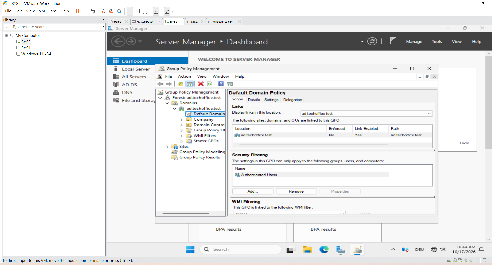
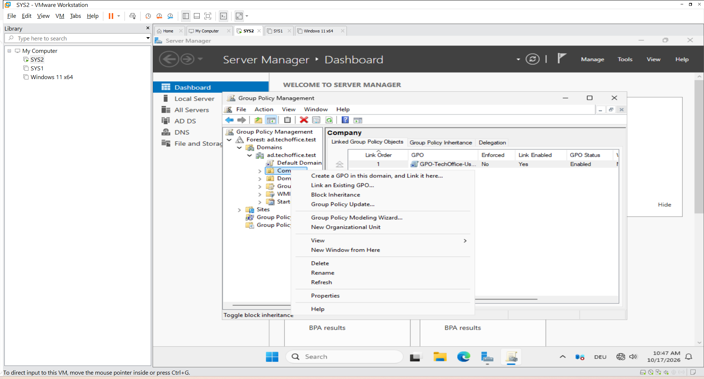
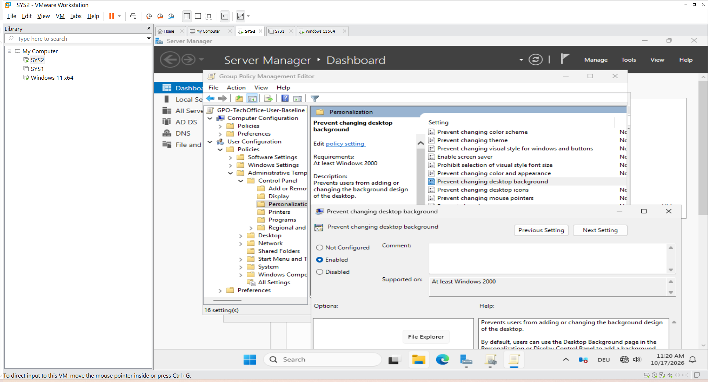
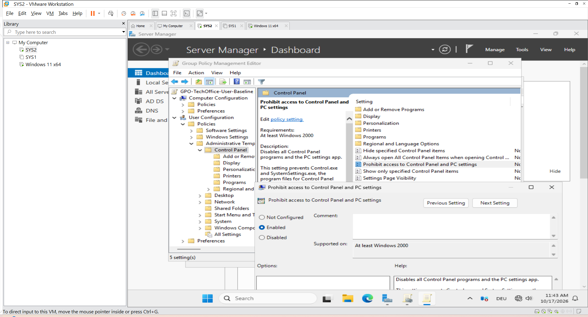
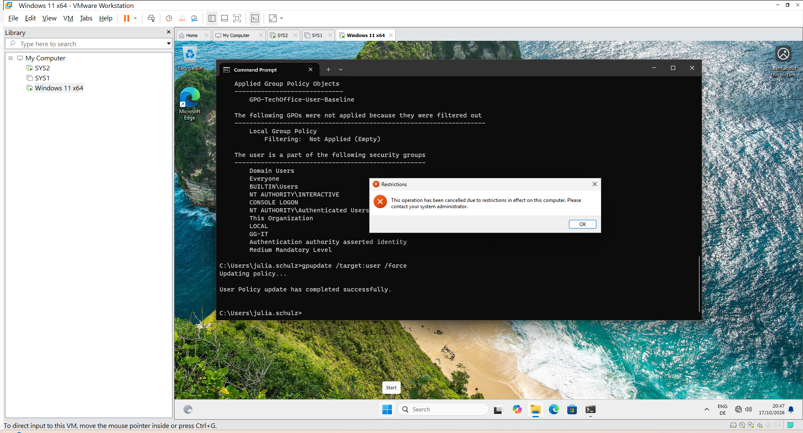
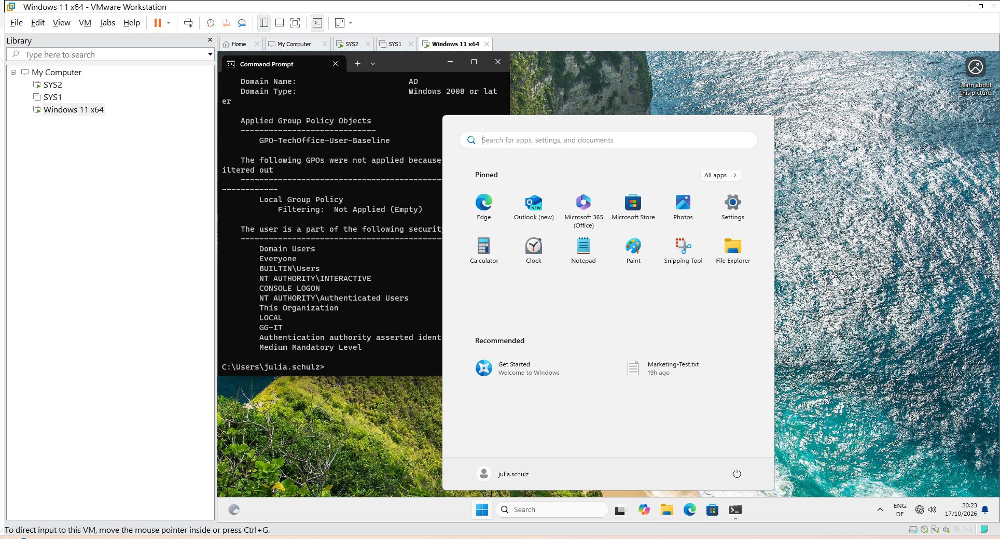
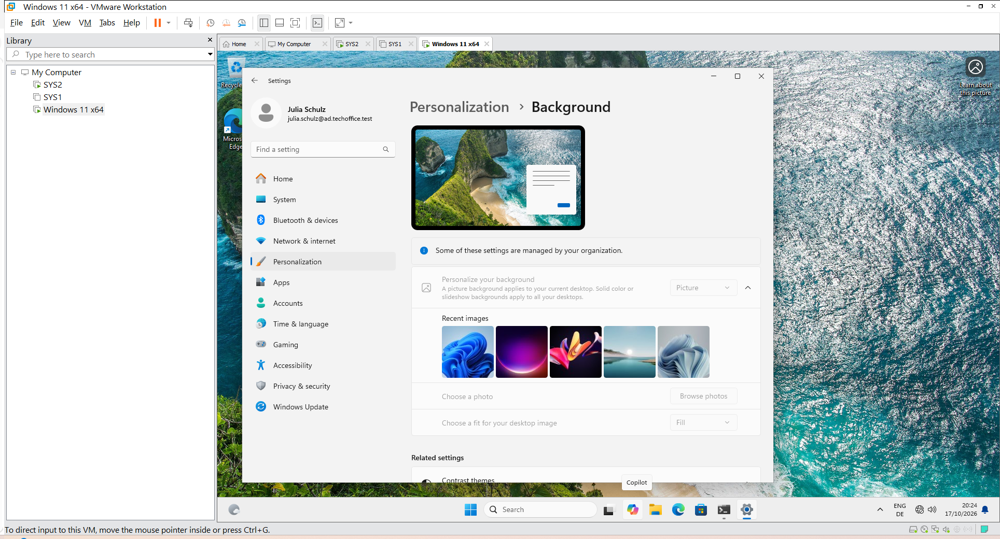
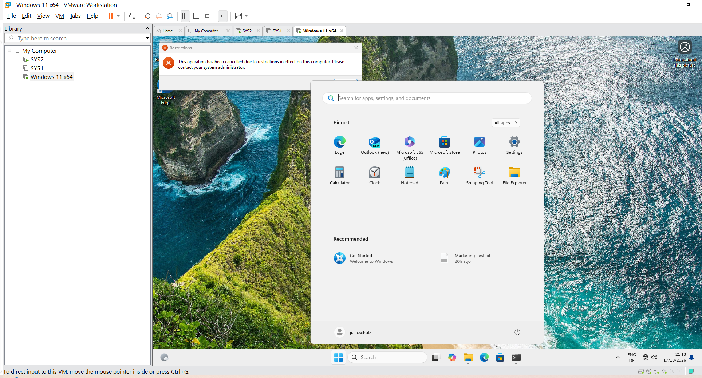

## Group Policy Management and User Restrictions

#### 1. Project Overview

This part of the TechOffice GmbH Windows Server administration lab demonstrates how to create, link, configure, apply, and verify Group Policy Objects (GPOs) in an Active Directory domain.

The first half focuses on applying user restrictions through a GPO linked to the Company organizational unit (OU). The second half will extend the lab by targeting selected users through security groups and Group Policy security filtering.

#### 2. Lab Environment

| Component | Configuration |
|---|---|
| Company | TechOffice GmbH |
| Server operating system | Windows Server 2025 |
| Server hostname | SRV-DC01 |
| Active Directory domain | ad.techoffice.test |
| Active Directory OU | Company |
| Group Policy Object (GPO) | GPO-TechOffice-User-Baseline |
| GPO link location | Company OU |
| GPO status | Enabled |
| Security filtering | Authenticated Users |
| User policy 1 | Prevent changing desktop background |
| User policy 2 | Prohibit access to Control Panel and PC settings |
| Client operating system | Windows 11 |
| Client computer role | Domain-joined workstation |
| Test user | Julia Schulz (AD\julia.schulz) |
| Policy verification | `gpupdate` and `gpresult /r` |
| Targeted GPO exercise | Planned — Security Filtering for selected users |

#### 3. Objectives

Create and link a Group Policy Object to an organizational unit.
Configure user-specific administrative template policies.
Refresh Group Policy on a Windows 11 domain client.
Verify policy application using gpresult.
Test the configured restrictions with a domain user account.
Understand the difference between OU-based GPO linking and security filtering.
Prepare a separate exercise for applying policies to selected users across departments.

#### 4. GPO Creation and Configuration

##### 4.1 Create the GPO

The GPO GPO-TechOffice-User-Baseline was created through Group Policy Management on SRV-DC01 and linked to the Company OU.
The GPO link was verified as enabled. The GPO status was also confirmed as enabled, and Authenticated Users was present in Security Filtering.
Because the GPO is linked to the parent Company OU, its applicable user settings can be inherited by user accounts in child OUs, provided normal Group Policy scope and permission requirements are satisfied.

##### 4.2 Configure the desktop background restriction

The following user policy was configured:

Policy: Prevent changing desktop background
Location:
User Configuration → Policies → Administrative Templates → Control Panel → Personalization
Configuration: Enabled
This setting restricts users covered by the GPO from changing their desktop background through the normal Windows personalization interface.

##### 4.3 Configure the Control Panel and Settings restriction

The following user policy was also configured:
Policy: Prohibit access to Control Panel and PC settings
Configuration: Enabled
This policy restricts access to Control Panel and the Windows Settings app for users covered by the GPO.
Both policies were configured under User Configuration, because the intention was to apply the restrictions to user accounts rather than to a particular computer.

#### 5. Applying and Verifying Group Policy

##### 5.1 Refresh user policy

On the Windows 11 client, signed in with Julia Schulz's domain account, the following command was used:
gpupdate /target:user /force
The user policy update completed successfully.

##### 5.2 Verify the applied GPO

The following command was used to inspect the resulting policy information:
gpresult /r

The output showed:
User: AD\julia.schulz
Group Policy applied from: SRV-DC01.ad.techoffice.test
Applied Group Policy Objects: GPO-TechOffice-User-Baseline
This confirmed that the GPO was being applied to Julia's user account.

#### 6. Functional Testing

###### Test 1 — Desktop background restriction

Procedure: Signed in as Julia and opened the Windows personalization settings.
Expected result: Julia should not be able to change the desktop background through the normal personalization interface.
Observed result: The desktop background restriction worked as expected.
Status: Passed

###### Test 2 — Control Panel and Settings restriction

Procedure: Attempted to access Control Panel and Windows Settings while signed in as Julia.
Expected result: Access should be restricted by the configured user policy.
Observed result: Windows displayed a restriction message indicating that the operation was restricted and that an administrator should be contacted.
Status: Passed

#### 7. Understanding GPO Scope

The GPO is linked to the Company OU and has Authenticated Users in Security Filtering. Therefore, its user settings are not intended for Julia alone. They can apply to other in-scope user accounts under the Company OU as well.
The scope of a GPO is influenced by its link location, inheritance, security filtering, permissions, and any applicable policy-processing settings.
A GPO linked to an OU does not automatically target a single user. To apply a different set of restrictions to selected users, a separate GPO with suitable security filtering can be used.
